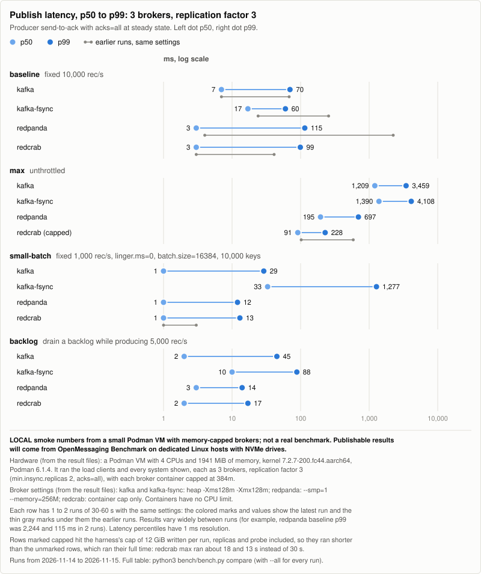
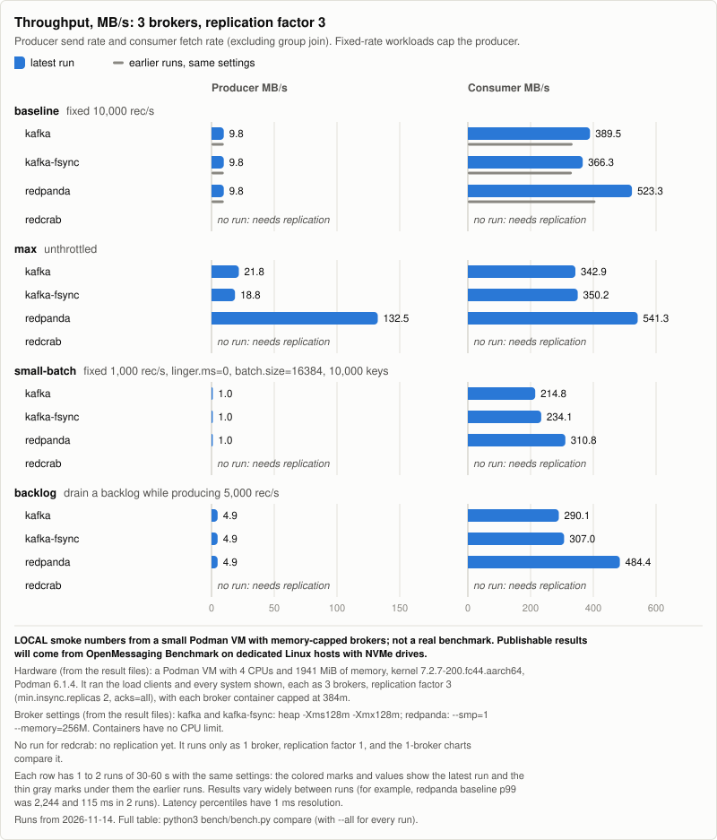

# redcrab

redcrab is a streaming broker that speaks the Apache Kafka wire protocol. It is written from scratch in Rust
and ships as a single binary, with no JVM and no ZooKeeper. It is tested with the stock Apache Kafka Java
command-line tools. The project started after the `redpanda-data/redpanda` repository was archived on GitHub (its last
GitHub release was v26.2.2). redcrab is a clean-room implementation, not a port. It is written from the public Kafka
protocol documentation, plus the Raft paper for replication, and it contains no source code from Redpanda or Apache
Kafka. The benchmark against Kafka and Redpanda is the project's most important deliverable, and it was built before
the broker.

> [!WARNING]
> **Status: pre-alpha. Not for production.**
> redcrab runs as a single node or as a cluster with a fixed set of nodes that replicates every partition with Raft.
> Replication is new: it has been tested only by the test suite and in a local Podman VM, including killing
> partition leaders under load. The set of nodes cannot change after the first start, and there are no metadata
> snapshots. redcrab has no TLS, no authentication and no authorization, neither on the Kafka listener nor on the
> internal port that the nodes replicate over. A known parsing issue means a large crafted request can still crash
> it on Linux (see [Security and known issues](#security-and-known-issues)). Do not put production data on it, and
> do not expose it to untrusted networks. It has been tested on macOS and, in the benchmark harness, in Linux arm64
> containers.

## Contents

- [Features](#features)
- [Quickstart](#quickstart)
- [Configuration](#configuration)
- [Kafka API compatibility](#kafka-api-compatibility)
- [Benchmark](#benchmark)
- [Migrating from Apache Kafka](#migrating-from-apache-kafka)
- [Migrating from Redpanda](#migrating-from-redpanda)
- [Architecture](#architecture)
- [Development](#development)
- [Security and known issues](#security-and-known-issues)
- [Roadmap](#roadmap)
- [Contributing](#contributing)
- [License](#license)

## Features

### Works today

- **One node, or a cluster with a fixed set of nodes.** Each node has one plaintext TCP listener that speaks the
  Kafka protocol. In a cluster, the nodes also talk to each other over an internal RPC listener. Every node is
  named on the command line (`--peers`), and that set cannot change after the first start.
- **Replication with Raft, one group per partition.** Each partition is a Raft group over its replicas: the group's
  leader is the Kafka partition leader and its term is the leader epoch. The cluster metadata (topics and committed
  consumer offsets) is one more Raft group over every node, and its leader is the controller. When a leader dies,
  the remaining majority elects a new one. In the local harness, a producer saw 2 to 8 seconds without
  acknowledgements per leader kill, and no acknowledged record was lost (see
  [Checking failover](#checking-failover)). Each new leader writes a no-op control
  batch (a `COMMIT` marker, which consumers skip), so a partition's offsets are not contiguous.
- **Topics:** create, delete, list and describe them, by name or by topic id. A topic can have 1 to 10,000
  partitions and a replication factor from 1 to the number of nodes (by default 3, or the number of nodes if that is
  smaller). Explicit replica assignments are accepted. Admin requests can go to any node, which forwards them to
  the controller. Topics are never created automatically.
- **Produce** with `acks=0`, `acks=1` and `acks=all`. With `acks=1` and `acks=all`, a batch is acknowledged once
  a majority of its partition's replicas have fsynced it (on a single node: once it is fsynced). The leader sends
  batches to its followers while its own fsync runs, and appends that arrive during an fsync share the next one
  (group commit), on leaders and followers alike. `acks=0` requests take the same write path but get no response.
- **Fetch** from the partition leader, with long polling (`fetch.max.wait.ms` and `fetch.min.bytes` are honoured).
  Reads stop at the high watermark, which is the offset committed on a majority, so consumers only see data that a
  majority of replicas have fsynced.
- **ListOffsets** for the earliest offset, the latest offset and lookups by timestamp, and **OffsetsForLeaderEpoch**,
  which clients use to detect divergence after a leader change.
- **Classic consumer groups:** join, sync, heartbeat and leave, coordinated by the controller. The group rebalances
  when a member joins, leaves or lets its session expire. Committed offsets go through the metadata log, so they are
  fsynced on a majority before the commit is acknowledged, and they survive `kill -9` and a controller change.
- **Storage:** a segmented log on disk with a sparse index and a checkpoint of where each leader epoch starts.
  CRC-32C is checked on every produced and replicated batch and on the batches scanned during crash recovery.
  Recovery truncates a torn tail. A failed write or fsync stops the process.
- **Tested end to end** with the stock Apache Kafka 4.4.0 Java command-line tools (`kafka-topics`,
  `kafka-producer-perf-test`, `kafka-verifiable-producer`, `kafka-console-consumer`, `kafka-consumer-perf-test`
  and `kafka-consumer-groups`) on one node and on a three-node cluster, including a test that kills partition
  leaders under load and checks that every acknowledged record can still be read.
- **136 automated tests**, and the code is clean under Clippy, including the pedantic lints.

### Not yet

| Capability | Status today |
| --- | --- |
| Membership changes | The set of nodes is fixed by `--peers` at the first start and checked on every start. Nodes cannot be added, removed or replaced, and partitions cannot be moved between nodes. |
| Snapshots and log cleanup | Logs keep everything from offset 0. Every start replays the whole metadata log, which grows with every topic change and every offset commit. |
| In-sync replica tracking | `Metadata` reports every replica as in sync. `min.insync.replicas` is ignored: a write always needs a majority of the partition's replicas. |
| `acks=1` | Waits for a majority, like `acks=all`. |
| Leader balancing | Only a new partition's first election favours its preferred replica. After failures, leadership stays wherever elections put it. |
| Data directories from before replication | Not readable. redcrab refuses to start on a non-empty data directory that it did not create with this version. |
| Idempotent producer de-duplication | Producer ids are issued, but sequence numbers are not checked. A retried batch can be stored twice. |
| Transactions and exactly-once | Not supported. Transactional producers are refused. |
| KIP-848 consumer protocol (`group.protocol=consumer`) | Not supported. Use the classic protocol, which is the default in the Kafka 4.4.0 Java client. |
| Static group membership (`group.instance.id`) | Accepted but not honoured. Static members rejoin as dynamic members. |
| Fetch sessions (KIP-227) | Not supported. redcrab never creates a session, so clients send full fetch requests. |
| Topic configs | Accepted when a topic is created, then ignored. `DescribeConfigs` returns no entries, and configs cannot be altered. |
| Retention and compaction | Not implemented. Data is never deleted, except by deleting the whole topic. |
| Adding partitions, deleting records, deleting groups, altering configs | These APIs are not implemented. |
| TLS, SASL, ACLs, quotas | Not implemented. Any client that can connect has full access. The internal RPC listener between nodes is not authenticated or encrypted either. |
| Metrics | None. The only output is the log. |
| Tiered storage, schema registry, HTTP proxy | Not implemented. |
| Platforms | Tested on macOS and, in the benchmark harness and the test suite, in a Linux arm64 container. Linux is the target platform; it has not been run on dedicated Linux hosts or on x86-64. Windows is not supported, because the storage layer uses Unix file APIs. Outside Linux, a node notices a peer whose address vanished (a crashed host) only after the kernel's TCP retransmission timeout, which can take minutes, so a restarted peer may wait that long to rejoin. |

## Quickstart

There are no prebuilt binaries or container images yet. You build redcrab from source.

### Build and run

You need a Rust toolchain that supports edition 2024 (`Cargo.toml` declares `rust-version = "1.89"`).

```sh
git clone https://github.com/Shindora/redcrab.git
cd redcrab
cargo build --release
./target/release/redcrab
```

With no flags, redcrab listens on `0.0.0.0:9092`, tells clients to connect to `127.0.0.1:9092`, and stores data
in `./redcrab-data`. It logs to stderr, starting with a line like this:

```text
INFO redcrab: listening local=0.0.0.0:9092 advertised=127.0.0.1:9092
```

Stop it with Ctrl-C. Every write acknowledged with `acks=1` or `acks=all` is already on disk, so an abrupt stop
loses nothing that was acknowledged.

### Clients and the advertised address

A Kafka client uses `bootstrap.servers` only for its first connection. After that, it connects to the host and
port that the broker advertises in its `Metadata` and `FindCoordinator` responses. redcrab advertises
`--advertised-host` (default `127.0.0.1`) and `--advertised-port` (default: the port it listens on).

Inside a container, `127.0.0.1` is the container itself. So when the clients run in a container, start redcrab
with an advertised host that resolves to your machine from inside the container:

```sh
# Podman
./target/release/redcrab --advertised-host host.containers.internal

# Docker Desktop
./target/release/redcrab --advertised-host host.docker.internal
```

For clients on other machines, advertise a DNS name or IP address that those machines can reach. redcrab has one
listener and advertises one address, so every client must be able to use that same address.

### Create a topic, produce and consume with stock Kafka tools

The examples below run the Apache Kafka command-line tools from the official `apache/kafka` image with Podman,
and they assume redcrab was started with `--advertised-host host.containers.internal`. For Docker Desktop,
replace `podman` with `docker` and `host.containers.internal` with `host.docker.internal`. If you have a local
Kafka distribution, you can run the same scripts directly with `localhost:9092`, against a redcrab started with
the default advertised host.

```sh
kafka_cli() { podman run --rm -i docker.io/apache/kafka:4.4.0 "$@"; }

kafka_cli /opt/kafka/bin/kafka-topics.sh --bootstrap-server host.containers.internal:9092 \
  --create --topic demo --partitions 3 --replication-factor 1

kafka_cli /opt/kafka/bin/kafka-topics.sh --bootstrap-server host.containers.internal:9092 --list
kafka_cli /opt/kafka/bin/kafka-topics.sh --bootstrap-server host.containers.internal:9092 --describe --topic demo

printf 'hello\nfrom\nredcrab\n' | kafka_cli /opt/kafka/bin/kafka-console-producer.sh \
  --bootstrap-server host.containers.internal:9092 --topic demo

kafka_cli /opt/kafka/bin/kafka-console-consumer.sh --bootstrap-server host.containers.internal:9092 \
  --topic demo --group demo-group --from-beginning --max-messages 3

kafka_cli /opt/kafka/bin/kafka-consumer-groups.sh --bootstrap-server host.containers.internal:9092 \
  --describe --group demo-group

kafka_cli /opt/kafka/bin/kafka-topics.sh --bootstrap-server host.containers.internal:9092 --delete --topic demo
```

The consumer may print the records in a different order, because records on different partitions have no
ordering relative to each other. On a single node, the replication factor must be 1 (leaving it unset also
works). Any other value is rejected with `INVALID_REPLICATION_FACTOR`.

### Run a three-node cluster

Each node needs its own node id, Kafka listener, RPC listener and data directory. Every node gets the same
`--peers` list, which names every node of the cluster, itself included: its id, the address of its RPC listener,
and the Kafka address that clients are told to use. On one machine, with the clients in containers as above:

```sh
PEERS=1@127.0.0.1:19093/host.containers.internal:19092,2@127.0.0.1:29093/host.containers.internal:29092,3@127.0.0.1:39093/host.containers.internal:39092
for id in 1 2 3; do
  ./target/release/redcrab --node-id $id --listen 0.0.0.0:${id}9092 --rpc-listen 127.0.0.1:${id}9093 \
    --data-dir redcrab-data-$id --peers "$PEERS" &
done

kafka_cli /opt/kafka/bin/kafka-topics.sh --bootstrap-server host.containers.internal:19092 \
  --create --topic demo3 --partitions 6 --replication-factor 3
kafka_cli /opt/kafka/bin/kafka-topics.sh --bootstrap-server host.containers.internal:29092 --describe --topic demo3
```

The description shows three replicas per partition, with the leaders spread over the three nodes. The cluster
serves a partition while a majority of its replicas are up, so this cluster survives the loss of any one node.
A node that is stopped and started again with the same flags and data directory catches up on its own. On
separate hosts, give each node its host's address in `--peers` and keep the RPC port reachable from the other nodes
only. `bench/redcrab.yml` runs the same three-node setup as containers.

### Using a Kafka client library

Point `bootstrap.servers` at redcrab's advertised address (for example `127.0.0.1:9092`), or at several nodes of a
cluster. Before you start, create your topics with a replication factor no larger than the number of nodes, and
use the classic consumer group protocol. Other Kafka client libraries connect the same way, but only the Apache
Kafka 4.4.0 Java clients have been tested so far. If you hit a problem with another client, please report it.

## Configuration

redcrab is configured only with command-line flags. There is no configuration file.

| Flag | Default | Description |
| --- | --- | --- |
| `--listen <ip:port>` | `0.0.0.0:9092` | Kafka listener to bind. It must be an IP address and port. Hostnames are not accepted. |
| `--advertised-host <host>` | `127.0.0.1` | Host that clients are told to connect to, in `Metadata` and `FindCoordinator` responses. Single node only. |
| `--advertised-port <port>` | the port bound by `--listen` | Port that clients are told to connect to. Single node only. |
| `--data-dir <path>` | `redcrab-data` (relative to the working directory) | Directory for the metadata log and the partition logs. It is created if it is missing, and it belongs to one node of one cluster. |
| `--node-id <int>` | `0` | Broker id, from 0 to 32767. Required with `--peers`. |
| `--peers <list>` | none (a cluster of this node alone) | Every node of the cluster, this one included, as comma-separated `ID@RPC_HOST:RPC_PORT/KAFKA_HOST:KAFKA_PORT` entries: the node id, the address of its RPC listener, and the Kafka address clients are told to use. This node's entry replaces `--advertised-host` and `--advertised-port`. Every node must get the same list, and it cannot change after the first start. |
| `--rpc-listen <ip:port>` | none | Internal RPC listener that the other nodes connect to. Required when `--peers` lists other nodes. It has no authentication or encryption: expose it to the other nodes only. |

Every flag takes a value. An unknown flag, a missing value or an invalid value prints the usage line and exits
with status 1. There is no `--help` flag. A single node started without `--peers` behaves as a cluster of one.

Logging goes to stderr. Set `RUST_LOG` to a single level (`error`, `warn`, `info`, `debug` or `trace`; the default
is `info`). Anything else, including per-module filters, falls back to `info`. At `debug`, every request is logged
with its API key, version and client id.

### Built-in limits

These values are fixed in the code and cannot be configured yet.

| Limit | Value |
| --- | --- |
| Request size | 100 MiB per request frame. A larger size prefix closes the connection. |
| In-flight requests | 32 per connection. |
| Partitions per topic | 1 to 10,000. |
| Topic names | 1 to 249 characters from `[a-zA-Z0-9._-]`, and not `.` or `..`. |
| Record batch size | 8 MiB per batch, so that replicating one fits in an internal frame. |
| Log segment size | 1 GiB. A new segment starts once the active one reaches this size. |
| Raft timing | Election timeout randomised between 1.5 and 3 seconds; heartbeats every 150 ms. |
| Sparse index interval | About one index entry per 4 KiB of log. |
| Consumer group id | At most 120 bytes. |
| Session timeout | At most 30 minutes. |
| Offset commit metadata | At most 4096 bytes. |

## Kafka API compatibility

redcrab implements the APIs below, and its `ApiVersions` response advertises exactly these version ranges. Clients
negotiate down to them automatically.

| Key | API | Versions | Notes |
| ---: | --- | --- | --- |
| 0 | Produce | 3–13 | On partition leaders. `acks` 0, 1 and -1; 1 and -1 wait for a majority. Only v2 record batches are accepted, and their CRC-32C is checked. From v13, topics are addressed by id. |
| 1 | Fetch | 4–18 | On partition leaders. Sessionless only. Long polling. Reads stop at the high watermark, so only data fsynced on a majority is returned. The current leader epoch is checked when the client sends it. |
| 2 | ListOffsets | 1–6 | On partition leaders. Earliest, latest and timestamp lookups. Capped at v6, so max-timestamp lookups are not available. |
| 3 | Metadata | 0–13 | Reports every node, the controller, and each partition's leader, leader epoch and replicas. Every replica is reported in sync. Topics are never auto-created. |
| 8 | OffsetCommit | 2–9 | On the controller. Offsets are committed to the metadata log, on a majority, before the response is sent. |
| 9 | OffsetFetch | 1–9 | On the controller. |
| 10 | FindCoordinator | 0–6 | Returns the controller for groups. Transaction coordinator lookups are refused. |
| 11 | JoinGroup | 0–9 | Classic protocol. `group.instance.id` is echoed back but not honoured. |
| 12 | Heartbeat | 0–4 | |
| 13 | LeaveGroup | 0–5 | |
| 14 | SyncGroup | 0–5 | |
| 15 | DescribeGroups | 0–6 | |
| 16 | ListGroups | 0–5 | Supports the state and type filters. |
| 18 | ApiVersions | 0–4 | A request at a newer version gets a v0 reply, so the client downgrades. |
| 19 | CreateTopics | 2–7 | Any node; forwarded to the controller. Replication factor from 1 to the number of nodes, or -1 for 3 (or the number of nodes, if smaller). Explicit replica assignments are accepted. Configs are ignored. `validate_only` is supported. |
| 20 | DeleteTopics | 1–6 | Any node; forwarded to the controller. By name, or by topic id from v6. |
| 22 | InitProducerId | 0–5 | Non-transactional producers only. Ids are issued, but sequence numbers are not checked. |
| 23 | OffsetForLeaderEpoch | 2–4 | On partition leaders. Where a leader epoch ends in the log. |
| 32 | DescribeConfigs | 1–4 | Topics and the broker. Every config list comes back empty. |

Every other API is unimplemented, and requests for one are logged at `warn` as `unsupported request`. For a few of
them, redcrab replies with an `UNSUPPORTED_VERSION` error (`SaslHandshake`, `SaslAuthenticate`, `DescribeCluster`,
`ConsumerGroupHeartbeat`, `AddOffsetsToTxn`, `EndTxn`, `GetTelemetrySubscriptions`, `PushTelemetry`). Any other
unimplemented request, and any version outside the ranges above, closes the connection. Clients that read
`ApiVersions` first do not send APIs or versions that the broker does not advertise.

## Benchmark

The benchmark against Apache Kafka and Redpanda is treated as the project's most important deliverable, and it
was built before the broker. Its goal is to produce numbers that anyone can reproduce, comparing the systems under
the same durability guarantees.

No benchmark results have been published yet. The charts below come from the local harness, in two setups:

- **One broker, replication factor 1.** Every system runs as a single broker that keeps one copy of each record.
  It measures a broker on its own, without the cost of replication.
- **Three brokers, replication factor 3.** Every system runs as a three-broker cluster that keeps three copies of
  each record and waits for at least two before acknowledging.

> [!WARNING]
> These charts show a local smoke test, not a benchmark.
>
> - Every system ran inside a 4-CPU Podman VM with about 2 GiB of memory on a laptop, driven by the same client
>   containers, with each broker container capped at 384 MiB.
> - The containers have no CPU limit, but Redpanda runs with `--smp=1 --memory=256M` and Kafka with a 128 MiB heap,
>   in both setups. A single Redpanda broker therefore uses one core, while a single Kafka or redcrab broker can use
>   all four.
> - In the 1-broker charts, every system ran as one broker with replication factor 1 and
>   `min.insync.replicas=1`. They measure a single broker only and say nothing about the cost of replication.
> - In the 3-broker charts, every system ran with replication factor 3 and `min.insync.replicas=2`. redcrab
>   ignores that setting, but it needs the same two of three copies, because a write needs a majority. All three
>   brokers of a cluster share the VM's 4 CPUs and one disk, so a 3-broker run does three times the disk and CPU
>   work of a 1-broker run on the same hardware.
> - Each run lasts 30 to 60 seconds, except redcrab's 3-broker `max` runs, which the harness's record cap stopped
>   after about 13 to 18 seconds. Results vary a lot from run to run, sometimes several-fold at p99, and
>   latency percentiles have 1 ms resolution. Most rows are a single run; where there are more, each chart row
>   shows the latest run, with the earlier runs of the same settings as thin gray marks under it.
> - The Kafka and Redpanda runs are from an earlier session on the same VM; only redcrab was run again after its
>   replication landed.
>
> Publishable results will come from [OpenMessaging Benchmark](#openmessaging-benchmark) runs on dedicated Linux
> hosts with NVMe drives. Each chart repeats these caveats in its caption.

### One broker, replication factor 1

<picture>
  <source media="(prefers-color-scheme: dark)" srcset="bench/charts/1-broker-rf1-latency-dark.svg">
  
</picture>

<picture>
  <source media="(prefers-color-scheme: dark)" srcset="bench/charts/1-broker-rf1-throughput-dark.svg">
  
</picture>

### Three brokers, replication factor 3

<picture>
  <source media="(prefers-color-scheme: dark)" srcset="bench/charts/3-broker-rf3-latency-dark.svg">
  
</picture>

<picture>
  <source media="(prefers-color-scheme: dark)" srcset="bench/charts/3-broker-rf3-throughput-dark.svg">
  
</picture>

The numbers behind the charts, as the latest run with the range over all charted runs in parentheses. Latency is
producer send to acknowledgement with `acks=all`, in milliseconds; throughput is in MB/s.

| Setup | Workload | System | Runs | p50 | p99 | Producer | Consumer |
| --- | --- | --- | ---: | ---: | ---: | ---: | ---: |
| 1 broker | `baseline` | kafka | 3 | 2 (2–2) | 24 (24–81) | 9.8 | 110 (86–110) |
| 1 broker | `baseline` | kafka-fsync | 3 | 2 (2–2) | 8 (8–159) | 9.8 | 239 (225–240) |
| 1 broker | `baseline` | redpanda | 3 | 2 (2–2) | 8 (8–91) | 9.8 | 379 (273–392) |
| 1 broker | `baseline` | redcrab | 2 | 2 (2–2) | 6 (6–6) | 9.8 | 395 (395–396) |
| 1 broker | `max` | kafka | 2 | 888 (888–1,030) | 2,867 (2,867–3,079) | 30.5 (26.4–30.5) | 458 (440–458) |
| 1 broker | `max` | kafka-fsync | 2 | 1,612 (1,612–24,636) | 7,006 (7,006–75,548) | 13.7 (1.1–13.7) | 84 (79–84) |
| 1 broker | `max` | redpanda | 2 | 10 (8–10) | 207 (124–207) | 257.1 (257.1–305.7) | 251 (251–357) |
| 1 broker | `max` | redcrab | 2 | 7 (7–11) | 165 (165–247) | 303.8 (293.7–303.8) | 348 (345–348) |
| 1 broker | `small-batch` | kafka | 1 | 1 | 9 | 1.0 | 292 |
| 1 broker | `small-batch` | kafka-fsync | 1 | 2 | 4 | 1.0 | 337 |
| 1 broker | `small-batch` | redpanda | 1 | 1 | 8 | 1.0 | 266 |
| 1 broker | `small-batch` | redcrab | 2 | 1 (1–1) | 5 (5–5) | 1.0 | 383 (383–451) |
| 1 broker | `backlog` | kafka | 1 | 2 | 10 | 4.9 | 461 |
| 1 broker | `backlog` | kafka-fsync | 1 | 3 | 193 | 4.9 | 409 |
| 1 broker | `backlog` | redpanda | 1 | 296 | 2,831 | 4.9 | 45 |
| 1 broker | `backlog` | redcrab | 1 | 2 | 7 | 4.9 | 606 |
| 3 brokers | `baseline` | kafka | 2 | 7 (7–7) | 70 (68–70) | 9.8 | 390 (334–390) |
| 3 brokers | `baseline` | kafka-fsync | 2 | 17 (17–24) | 60 (60–256) | 9.8 | 366 (332–366) |
| 3 brokers | `baseline` | redpanda | 2 | 3 (3–4) | 115 (115–2,244) | 9.8 | 523 (407–523) |
| 3 brokers | `baseline` | redcrab | 2 | 3 (3–3) | 99 (41–99) | 9.7 (9.7–9.8) | 397 (366–397) |
| 3 brokers | `max` | kafka | 1 | 1,209 | 3,459 | 21.8 | 343 |
| 3 brokers | `max` | kafka-fsync | 1 | 1,390 | 4,108 | 18.8 | 350 |
| 3 brokers | `max` | redpanda | 1 | 195 | 697 | 132.5 | 541 |
| 3 brokers | `max` | redcrab (capped) | 2 | 91 (91–102) | 228 (228–586) | 203.6 (149.9–203.6) | 428 (410–428) |
| 3 brokers | `small-batch` | kafka | 1 | 1 | 29 | 1.0 | 215 |
| 3 brokers | `small-batch` | kafka-fsync | 1 | 33 | 1,277 | 1.0 | 234 |
| 3 brokers | `small-batch` | redpanda | 1 | 1 | 12 | 1.0 | 311 |
| 3 brokers | `small-batch` | redcrab | 2 | 1 (1–1) | 13 (3–13) | 1.0 | 363 (363–388) |
| 3 brokers | `backlog` | kafka | 1 | 2 | 45 | 4.9 | 290 |
| 3 brokers | `backlog` | kafka-fsync | 1 | 10 | 88 | 4.9 | 307 |
| 3 brokers | `backlog` | redpanda | 1 | 3 | 14 | 4.9 | 484 |
| 3 brokers | `backlog` | redcrab | 1 | 2 | 17 | 4.9 | 398 |

redcrab's 3-broker `max` row is marked capped, because the harness now stops every run at 12 GiB written,
counting every replica and the probe (see [Running the local harness](#running-the-local-harness)). At replication
factor 3 that is 4,194,304 records of 1 KiB, of which the probe may write a third. redcrab's probes measured about
200,000 records/s, enough for about six million records in 30 s, so both runs were cut to the remaining 2.8 million
records and lasted about 18 and 13 s instead of 30 s. The Kafka and Redpanda `max` runs predate the cap and ran
their full 30 s, so the redcrab row covers a shorter run than the others. The 3-broker `backlog` run writes 3.3
million records, which fits under the cap, so it ran in full like the others. The two 1-broker `small-batch` runs
of redcrab are within the range of the other systems (p99 5 ms); an earlier single run of the pre-replication
broker had shown 87 ms, caused by a stall in its last few seconds rather than by every request.

The harness writes these numbers to `bench/results/`, which is not committed. `python3 bench/bench.py compare`
prints them as one table per setup, `compare --all` lists every run, and `python3 bench/bench.py chart` redraws the
charts.

### Fairness rules

- **Same client, same settings.** Every system is driven by the same Kafka client: the perf tools from one pinned
  `apache/kafka:4.4.0` image in the local harness, and the same Kafka driver in OpenMessaging Benchmark. Producer
  and consumer settings are identical for every system.
- **One setup per comparison.** Results from different setups are never mixed in one table or chart.
  - One broker: replication factor 1, `acks=all` and `min.insync.replicas=1` on every system. Kafka's internal
    topics (consumer offsets, transaction state and share-group state) also use replication factor 1. Redpanda
    limits its consumer offsets topic to its one broker without any setting.
  - Three brokers: replication factor 3, `acks=all` and `min.insync.replicas=2` on every system (redcrab always
    needs a majority, which for three replicas is the same two).
- **Same resources.** Both setups use the same pinned images, the same VM, the same client containers and settings,
  the same workloads and the same 384 MiB cap per broker container.
- **Kafka is measured in two modes.** The first is Kafka's default, which does not fsync before acknowledging.
  The second sets `flush.messages=1`, which fsyncs every append before acknowledging. The local harness sets this
  broker-wide as `log.flush.interval.messages=1`, and the OMB driver sets it as a topic config. Redpanda and
  redcrab both fsync before acknowledging, so the `flush.messages=1` run is the like-for-like comparison. The
  default run is included because it is Kafka's default configuration.
- **Redpanda runs with write caching disabled, and not in dev-container mode.** The local harness sets
  `write_caching_default=false` and reads it back with `rpk`; the OMB driver also sets the topic config
  `write.caching=false`. The compose file turns `developer_mode` off before the broker starts, and the harness
  records the node config's `developer_mode` and the arguments of the running `redpanda` process. Dev-container
  mode would show up as `developer_mode: true` and `--unsafe-bypass-fsync`.
- **The settings in effect are recorded.** Each local result file records the broker count, the replication
  factor and `min.insync.replicas`, and the producer acks. It also records Kafka's broker flush setting with its
  broker configs as read back (flush interval, `min.insync.replicas` and internal-topic replication), Redpanda's
  write-caching value, developer mode and start arguments, and the effective topic configs as read back from the
  cluster. The result file name ends in the broker count and replication factor, for example
  `-1-broker-rf1.json`.
- **Published numbers come from long runs on pre-filled disks**, so they reflect steady state rather than an
  empty drive.

### Workloads

Every workload uses 1 KiB records, 100 partitions and `acks=all`, with replication factor 1 and
`min.insync.replicas=1` on one broker, or replication factor 3 and `min.insync.replicas=2` on three brokers.
The producer uses `linger.ms=1` and `batch.size=131072`, except in small-batch. The consumer uses
`fetch.max.bytes=16777216`.

| Workload | Shape | Local harness | OMB workload file |
| --- | --- | --- | --- |
| `baseline` | Fixed-rate open loop. | 10,000 records/s. | 50,000 msg/s. |
| `max` | Highest sustainable throughput. | Unthrottled. A 15 s probe measures the rate, which sets how many records the run sends, up to the harness's record cap. | `producerRate: 0`, so OMB searches for the maximum rate. |
| `small-batch` | `linger.ms=0`, `batch.size=16384`, random keys. | 1,000 records/s over 10,000 keys. | 10,000 msg/s. |
| `backlog` | Consumers drain a backlog while producers keep writing. | Pre-fills 50,000 × `--seconds` records unthrottled, then drains them from the start while a producer writes 5,000 records/s. | 50 GB backlog, 50,000 msg/s. |

The OMB workload files use 4 producers and 4 consumers, a 5-minute warm-up and a 15-minute measured run.

### Metrics

- Producer throughput, in records/s and MB/s.
- Producer latency from send to acknowledgement with `acks=all`: average, p50, p95, p99, p99.9 and max, measured
  at steady state with the warm-up excluded.
- Consumer throughput, in records/s and MB/s, excluding the time spent joining the group.
- For `backlog`: the drain rate while the live producer keeps writing.
- Broker memory after the load (local harness only).

### Running the local harness

You need Python 3.11 or newer, Podman with a working `podman compose`, and both images pinned at the top of
`bench/bench.py` (`KAFKA_IMAGE` and `REDPANDA_IMAGE`), pulled before you start. The `redcrab` target also needs the
Rust toolchain from [Build and run](#build-and-run) with the static Linux target for the CPU of your Podman VM:
`rustup target add aarch64-unknown-linux-musl` on Apple silicon, or `x86_64-unknown-linux-musl` on x86-64.

```sh
python3 bench/bench.py run <target> <workload> [--brokers 3] [--seconds 60] [--partitions 100]
python3 bench/bench.py compare [--all]
python3 bench/bench.py chart
```

- Targets: `kafka`, `kafka-fsync` (Kafka with `flush.messages=1`), `redpanda` and `redcrab`.
- Workloads: `baseline`, `max`, `small-batch` and `backlog`.
- `--brokers` is `3` (the default) or `1`, for every target, and the replication factor follows it. For example,
  `python3 bench/bench.py run redcrab baseline --brokers 1` is the 1-broker counterpart of
  `python3 bench/bench.py run kafka-fsync baseline --brokers 1`.
- `--seconds` is the number of measured seconds per phase. `baseline` and `small-batch` also run a 60 s warm-up
  that is left out of the summary, and `max` leaves out the first sixth of its run.

A run does the following:

1. Starts the cluster from `bench/kafka.yml` (KRaft, with combined broker and controller nodes),
   `bench/redpanda.yml` or `bench/redcrab.yml`: three brokers, or one with `--brokers 1`. The broker count sets
   the controller quorum, the seed list or redcrab's `--peers`, and for Kafka the replication factor and
   `min.insync.replicas` of its internal topics.
2. Waits for the brokers. For Kafka, it reads back the broker's flush and replication configs. For Redpanda, it
   turns write caching off, reads the value back with `rpk`, and records the node's developer mode and start
   arguments. Then it creates the topic and records its effective configs.
3. Drives the load with `kafka-producer-perf-test` and `kafka-consumer-perf-test` from throwaway client
   containers.
4. Tears the cluster down along with its volumes.
5. Writes `bench/results/<utc-timestamp>-<target>-<workload>-<brokers>-broker-rf<replication-factor>.json`.

`compare` prints one table per setup (broker count and replication factor) with the latest result for each
target and workload, and `compare --all` prints every result. `chart` draws one set of SVG charts per setup in
`bench/charts/` (`1-broker-rf1-*` and `3-broker-rf3-*`), one light and one dark file per chart, with the caveats
from the result files in each caption. It draws only runs whose brokers the harness started with the 384 MiB cap.
Each row shows the latest run; earlier runs with the same settings (same image or redcrab commit, the same
workload parameters and whether the record cap cut the run, and for redcrab the same binary) appear as thin gray
marks under it. A target without a
run in a setup reads "no run".

A `max` run sends as many records as its probe suggests the system can take in `--seconds`, and each record is
written once per replica, which for a fast replicated cluster would be tens of gigabytes. A Podman machine's disk
is a sparse file on the host that only shrinks when the harness runs `fstrim` after a run, and a full host disk
crashes the VM. So every run is capped at 12 GiB written, counting every replica and the probe: 4,194,304 records
of 1 KiB at replication factor 3, or 12,582,912 at 1, and fewer if that would leave less than 10 GiB free on the
disk that holds your home directory. The probe may write a third of the cap. A `max` run that would need more than
the rest is cut to it: the result file records this under `record_cap`, `compare` shows the run's length as
`~N capped`, and the charts label its row `(capped)`. Other workloads that would not fit are refused instead.

For `redcrab`, the harness first builds the broker from this checkout on your machine, not inside the small VM.
`cargo build --release --target <arch>-unknown-linux-musl` produces a static Linux binary linked against musl, so
it uses musl's memory allocator. It links with the `rust-lld` that ships with Rust, so no C toolchain is needed.
`podman build` then packages it with `bench/Containerfile` as the image `localhost/redcrab-bench:latest`. Both
steps are quick no-ops when nothing changed. The run starts that image as `bench-1` to `bench-3` (or `bench-1`
alone), each named in `--peers` with its RPC listener on port 9093, on the same network as the other clusters,
with the same 384 MiB container cap and data on a volume per broker. It creates the topic like for the other
systems, and it is driven by the same client containers. The result file records the image id, the git commit,
the Rust target and the SHA-256 of the binary.

To benchmark a redcrab that you started yourself, pass its address with `--bootstrap` (and, for a cluster,
`--replication-factor`; the default is 1). Use a fresh data directory for each run, because the harness creates
the topic `bench` and does not delete it:

```sh
./target/release/redcrab --listen 0.0.0.0:19092 --advertised-host host.containers.internal --data-dir "$(mktemp -d)"
python3 bench/bench.py run redcrab baseline --bootstrap host.containers.internal:19092
```

`compare` lists such runs under an unknown broker count, and the charts leave them out. A broker on the macOS host
also runs on different resources: there `fsync` uses `F_FULLFSYNC`, which costs much more than `fdatasync` inside
the VM, and the clients reach it over the slower network path between the VM and the host.

### Checking failover

```sh
python3 bench/bench.py verify-failover <target>
```

This starts three brokers of the target, creates a one-partition topic with replication factor 3 and runs
`kafka-verifiable-producer` at 1,000 records/s with `acks=all`, writing increasing integers. Three times, it looks
up the partition leader, kills its container with `podman kill`, waits until the producer gets acknowledgements
again, and starts the killed broker again. Then it reads the whole topic back with the console consumer and checks
that every record the producer saw acknowledged is there; duplicates from retries are allowed. It reports the
longest pause between acknowledgements after each kill, which is the failover time the client sees. The producer
keeps its default settings except `socket.connection.setup.timeout.ms=1000`: a killed container's address
disappears, so connecting to it would otherwise hang for the client's default 10 to 30 seconds and hide the
brokers' own failover time.

| Target | Runs | Pause after each kill (ms) | Acknowledged records missing |
| --- | --- | --- | --- |
| redcrab | 2 | 7,507, 3,728 and 2,190; 3,483, 2,399 and 2,642 | none of 64,583; none of 59,547 |
| kafka | 1 | 9,701, 13,403 and 12,372 | none of 87,109 |

These are single local runs in the same small VM as the benchmark. redcrab's pause is its Raft election timeout
(1.5 to 3 seconds, more after a split vote) plus the commit of the new leader's no-op batch. Kafka's controller
waits out its broker session timeout (9 seconds by default) before it moves leadership away from a broker that
stopped heartbeating.

> [!NOTE]
> Results from the local harness are smoke tests, not benchmark results. The harness runs memory-capped brokers
> (384 MiB containers, a 128 MiB Kafka heap, and Redpanda limited to one core and 256 MiB) inside a small Podman
> VM on a laptop. Every result file says so in its `note` field. Use them to check that the harness and the
> systems work, not to compare performance, and do not quote them as benchmark results.

### OpenMessaging Benchmark

Published numbers will come from [OpenMessaging Benchmark](https://github.com/openmessaging/benchmark) runs on
dedicated Linux hosts with NVMe drives. The configuration files are in `bench/omb/`:

- `bench/omb/drivers/` has one driver per system (`kafka`, `kafka-fsync`, `redpanda`, `redcrab`), plus a
  `*-small-batch` variant of each with the small-batch producer settings.
- `bench/omb/workloads/` has `baseline`, `max`, `small-batch` and `backlog`.

Run `small-batch` with the `*-small-batch` drivers and the other workloads with the plain drivers. The driver
files ship with `bootstrap.servers=localhost:9092` as a placeholder, so set it to the cluster under test. For
Redpanda, also confirm that `rpk cluster config get write_caching_default` prints `false`. The redcrab drivers use
replication factor 3 like the others, so they need a cluster of at least three redcrab nodes.

## Migrating from Apache Kafka

> [!IMPORTANT]
> redcrab is a pre-alpha broker whose replication has only been tested locally, so moving production traffic to it
> is not recommended yet. This section shows how to evaluate redcrab against an existing Kafka workload today, and
> outlines what the migration path is expected to be.

### 1. Check what the workload depends on

A workload is a candidate for evaluation only if it does not depend on any of the following:

- Adding, removing or replacing brokers, partition reassignment, rack awareness, or a replication factor above
  the number of nodes. A redcrab cluster has a fixed set of nodes.
- Transactions or exactly-once processing, such as `transactional.id` or Kafka Streams with
  `processing.guarantee=exactly_once_v2`.
- Retries that never produce duplicates. Idempotent producers start, but duplicates are not removed.
- The KIP-848 consumer protocol (`group.protocol=consumer`) or static membership (`group.instance.id`).
- Topic configs such as `retention.ms`, `retention.bytes`, `cleanup.policy=compact`, `max.message.bytes` or
  `min.insync.replicas`. They are accepted and ignored, so nothing is ever deleted or compacted.
- Topic auto-creation.
- Admin operations beyond creating, deleting, listing and describing topics, and listing and describing groups.
  That rules out adding partitions, altering configs, deleting records, deleting groups, ACLs, quotas and
  partition reassignment.
- TLS, SASL or ACLs.
- Broker metrics.
- Tools that have not been tested with redcrab. Kafka Connect, MirrorMaker 2, Kafka Streams and Schema Registry
  are all untested.

### 2. Adjust the client configuration

| Setting | On redcrab |
| --- | --- |
| `bootstrap.servers` | One or more redcrab nodes' advertised addresses. For plain producers and consumers, this is usually the only change. |
| `security.protocol` | `PLAINTEXT` only. Remove any SSL and SASL settings. |
| `acks` | `0`, `1` and `all` all work. Today `1` and `all` mean the same thing: the batch is fsynced on a majority of its partition's replicas. |
| `enable.idempotence` | The default (`true`) works, but duplicates caused by retries are not removed. |
| `transactional.id` | Not supported. Transactional producers fail when they initialize transactions. |
| `group.protocol` | `classic`, which is the default in the Kafka 4.4.0 Java client. `consumer` is not supported. |
| `group.instance.id` | Ignored. The consumer behaves as a dynamic member. |
| `isolation.level` | No effect. There are no transactions, so `read_committed` returns the same data as `read_uncommitted`. |
| `allow.auto.create.topics` | No effect. redcrab never creates topics automatically. |

### 3. Create the topics

Create each topic with the same name and partition count it has on the source cluster, and a replication factor
of 3 on a three-node cluster (1 on a single node):

```sh
kafka-topics.sh --bootstrap-server <redcrab-host>:9092 --create --topic orders --partitions 12 --replication-factor 3
```

### 4. Copy data for the evaluation

Committed consumer offsets do not carry over. Offsets on redcrab start at 0, and each leader election writes a
control batch that takes one offset, so offsets also drift from the source as leaders change. Consumer groups on
redcrab should start from the earliest offset.

For text data, you can pipe the stock console consumer into the stock console producer. Both tools separate the
key from the value with a tab by default. The null marker keeps null keys and values null instead of turning
them into the string `null`:

```sh
kafka-console-consumer.sh --bootstrap-server <kafka-host>:9092 --topic orders --from-beginning --timeout-ms 30000 \
    --formatter-property print.key=true --formatter-property null.literal=__NULL__ \
  | kafka-console-producer.sh --bootstrap-server <redcrab-host>:9092 --topic orders \
    --reader-property parse.key=true --reader-property null.marker=__NULL__
```

The consumer exits after 30 seconds without new records, and the producer then flushes and exits. To keep copying
new records as they arrive, leave out `--from-beginning` and `--timeout-ms`. Each tool can also run from the
`apache/kafka` image, as in the quickstart. The flag names above are from Kafka 4.4.0. The pipe has limits:

- It works line by line. A value that contains a newline, a key that contains a tab, or binary data will not copy
  correctly.
- Record headers and timestamps are not preserved.
- Records are partitioned again by the console producer's default partitioner, so the partition a key lands on
  can differ from the source.

For binary data, headers, timestamps or exact partition placement, write a short program with any Kafka client
library. It should consume from the source and produce to redcrab, copying the key, value, headers and timestamp
of each record and sending each record to the same partition number it came from.

### 5. Run the workload

Point a staging copy of the producers and consumers at redcrab, then watch two places:

- The client logs, for `UnsupportedVersionException` and similar errors. They mean the client needs an API that
  redcrab does not implement. Check the [compatibility table](#kafka-api-compatibility).
- The redcrab log. Unimplemented requests are logged at `warn` as `unsupported request`, with the API key and
  version. With `RUST_LOG=debug`, every request is logged.

### Planned migration path

This is subject to change, and none of it has been tried yet. With replication in place, the expected path is:

1. Run a redcrab cluster with replication factor 3 alongside the existing cluster.
2. Create the topics with matching partition counts.
3. Keep the data flowing from the source cluster to redcrab. Whether MirrorMaker 2 can be used for this has not
   been tested.
4. Move consumers first, then producers. Offsets differ between the two clusters, so consumer positions have to be
   re-established. How redcrab will support that has not been decided.
5. Keep the source cluster until the switch has been verified.

## Migrating from Redpanda

> [!IMPORTANT]
> redcrab is a pre-alpha broker whose replication has only been tested locally, so moving production traffic to it
> is not recommended yet. This section shows how to evaluate redcrab against an existing Redpanda workload today,
> and outlines what the migration path is expected to be.

Redpanda and redcrab both speak the Kafka protocol, so the client-side steps are the same as for
[Apache Kafka](#migrating-from-apache-kafka): check the dependency list, change `bootstrap.servers`, create the
topics, copy data with the stock Kafka tools, and run the workload. The stock Kafka
tools work against Redpanda as the source; the local benchmark harness drives Redpanda with them. The rest of
this section covers what is different.

### What has no equivalent yet

redcrab only speaks the Kafka protocol, on one port per node, plus its internal RPC port between nodes.

| Redpanda feature | redcrab today |
| --- | --- |
| Raft replication (replication factor 3) | Implemented, with a fixed set of nodes: no adding or decommissioning nodes, no partition movement, no leader balancing. |
| Tiered storage | Not implemented. |
| HTTP proxy | Not implemented. |
| Built-in schema registry | Not implemented. Clients that use a schema registry need a separate registry service; none has been tested with redcrab. |
| Data transforms | Not implemented. |
| Admin API | Not implemented. |
| `rpk` | Untested. Commands that go through the Redpanda Admin API cannot work. Commands that use the Kafka protocol have not been tested. |
| Redpanda Console | Untested. |
| Topic properties such as `write.caching` and `redpanda.*` | Accepted at creation and ignored, like all topic configs. |

### Durability differences

On a Redpanda cluster with write caching off, `acks=all` waits for a Raft majority of replicas, and so does
redcrab: a batch is acknowledged once a majority of its partition's replicas have fsynced it. On redcrab, `acks=1`
also waits for that majority. redcrab always fsyncs before acknowledging; there is no setting that turns this off.

### Copying data

Use the console consumer and console producer pipe from the
[Kafka section](#4-copy-data-for-the-evaluation), with the Redpanda cluster as the source. Copying with `rpk`
(for example `rpk topic consume` piped into `rpk topic produce`) has not been tested against redcrab.

### Planned migration path

The path is the same as the [planned path from Kafka](#planned-migration-path). Workloads that rely on tiered storage, the HTTP proxy, the built-in schema registry or data
transforms need those to be replaced by other components first. None of them is on the roadmap today.

## Architecture

redcrab is a library (`src/lib.rs`) plus a small binary (`src/main.rs`). Kafka connections run on a multi-threaded
Tokio runtime, with a reader task and a writer task each. The Raft groups run on a few shard threads (at most four),
fsyncs and reads run on Tokio's blocking thread pool, and the internal transport uses plain threads.

```text
client ── TCP ──> server.rs   frames, decodes and version-checks requests; writes responses in request order
                     │
                     └──> api.rs   one handler per Kafka API
                            ├──> broker.rs    leader lookups, producer ids, the group coordinator's state
                            │      └──> cluster.rs   static membership, metadata log (topics, offsets), admin forwarding
                            │             └──> replica.rs   shard threads driving one Raft group per partition
                            │                    ├──> raft.rs        Raft core: elections, replication, commit
                            │                    ├──> storage.rs     segmented partition log on disk
                            │                    └──> transport.rs   frames to and from the other nodes (RPC port)
                            └──> group.rs     classic consumer groups, on the controller
```

### Produce path

1. `server.rs` reads a size-prefixed request frame (100 MiB at most), decodes the header and checks the API
   version against the table in `api.rs`.
2. `api::produce` checks that this node leads each partition, splits the payload into v2 record batches and checks
   the framing and CRC-32C of each one. The batches are proposed to the partition's shard before the next request
   is read, so request order is append order.
3. The shard thread appends the batches to the leader's log at once (assigning offsets and stamping the leader
   epoch in each batch header) and sends them to the followers. An fsync of everything appended so far starts on
   the blocking pool; appends that arrive while it runs share the next one. Followers append what they receive,
   group their fsyncs the same way, and report how far they have fsynced.
4. Once a majority of the replicas (the leader counts once its own fsync is done) have fsynced a batch, it is
   committed: the high watermark advances, waiting fetches wake up and the proposal completes. A new leader first
   appends a no-op control batch of its own term; once that commits, its high watermark is current.
5. The produce response completes when all of its partitions are committed, or fails a partition with
   `NOT_LEADER_OR_FOLLOWER` if leadership changed first. The connection's writer task sends responses strictly in
   request order. `acks=0` requests follow the same path but get no response.

### Fetch path

1. `api::fetch` accepts sessionless fetches only, on partition leaders, and resolves topics by name, or by id from
   v13. A leader epoch sent by the client is checked against the current one.
2. If any partition has data past its fetch offset, if `min_bytes` is 0, or if the wait has expired, it locates
   whole batches on the blocking pool, starting with the batch that contains the fetch offset, within the
   partition and response byte limits, and streams them into the response. The first non-empty partition always
   returns at least one batch, so the consumer makes progress.
3. Reads are cut at the high watermark, which only moves when a majority has fsynced. That is why consumers never
   see data that could be lost in a failover.
4. Otherwise the fetch waits for the next commit on any partition, or for `max_wait_ms`, and tries again.

### Cluster metadata and consumer groups

`cluster.rs` keeps the topics and the committed consumer offsets in the metadata log, a Raft group over every node
whose leader is the controller. Creating or deleting a topic is a command appended to that log by the controller;
other nodes forward such requests to it over the transport. Every node applies the committed commands in order and
opens or removes its own replicas of the partitions. Replicas of a new topic are spread over consecutive nodes, so
leaders and replicas are balanced.

`group.rs` implements the classic group protocol on the controller, which coordinates every group. Group membership
lives in memory only: after a restart or a controller change, members find the new coordinator and rejoin. A timer
in the accept loop checks session and rebalance timeouts every 100 ms. Committed offsets are a command in the
metadata log, committed on a majority before the commit is acknowledged.

### On-disk layout

```text
<data-dir>/
├── node                                      this node's id and the cluster's node ids, checked on every start
├── metadata/                                 the metadata log
│   ├── 00000000000000000000.log              record batches; each record's value is one command
│   ├── 00000000000000000000.index
│   ├── epochs                                where each leader epoch starts
│   └── raft-state                            current term and vote
└── partitions/
    └── <topic-id>-<partition>/               one directory per replica of a partition
        ├── 00000000000000000000.log          record batches, byte for byte as produced (base offset and leader epoch set)
        ├── 00000000000000000000.index        sparse index: 16-byte big-endian entries
        ├── epochs
        └── raft-state
```

- **Segments.** Each segment is named after its base offset, zero-padded to 20 digits. A segment rolls at 1 GiB.
  Each index entry holds a relative offset (u32), a file position (u32) and the largest batch timestamp before
  that position (i64).
- **Index ordering.** Index entries reach the index file only after the log bytes they cover have been synced, so
  every entry on disk marks a point up to which the log is known to be durable.
- **Recovery.** On startup, only the active segment needs recovery, because sealed segments are fully synced
  before a new segment is rolled. The active segment is checked from its last durable index entry onwards, batch
  by batch, and the first torn or corrupt batch and everything after it are truncated. The epoch checkpoint is
  checked against the batches it names.
- **Truncation.** A follower whose log diverged from its new leader's truncates the uncommitted tail, durably,
  before it appends anything after it.
- **Small files.** The `node`, `epochs` and `raft-state` files are replaced atomically: written to a temporary file,
  fsynced, renamed over the old file, and then the directory is fsynced.
- **fsync calls.** Log flushes use `fdatasync` on Linux. On macOS, the Rust standard library issues
  `fcntl(F_FULLFSYNC)`, which also drains the drive's write cache.
- **Failed writes.** A failed write or fsync stops the process, because a later successful fsync would not prove
  that the earlier data reached the disk. The node recovers from its log when it is started again.

## Development

```sh
cargo build --release        # build target/release/redcrab
cargo test                   # unit tests plus end-to-end tests over TCP, including clusters (136 today)
cargo clippy --all-targets   # Clippy all + pedantic lints are enabled in Cargo.toml
cargo fmt --check            # formatting
```

The benchmark harness needs Python 3.11 or newer and Podman; see [Running the local harness](#running-the-local-harness).

### Project layout

| Path | Contents |
| --- | --- |
| `src/main.rs` | Command-line parsing and process startup. |
| `src/lib.rs` | Library root. |
| `src/server.rs` | TCP accept loop, request framing, in-order response writing, group timeout timer. |
| `src/api.rs` | One handler per Kafka API, and the advertised version table. |
| `src/broker.rs` | Kafka-facing state of a node: leader lookups, producer ids, the group coordinator. |
| `src/cluster.rs` | Static membership, the metadata log and what it builds (topics, committed offsets), admin forwarding, startup. |
| `src/replica.rs` | Shard threads that drive each Raft group over its log, group-commit fsyncs. |
| `src/raft.rs` | The Raft core: pre-vote, elections, replication, commit, as a state machine without I/O. |
| `src/transport.rs` | Framed TCP transport between nodes. |
| `src/group.rs` | Classic consumer group coordinator. |
| `src/storage.rs` | Segmented partition log, sparse index, epoch checkpoint, truncation, crash recovery. |
| `tests/roundtrip.rs` | End-to-end tests against a single broker over TCP. |
| `tests/cluster.rs` | End-to-end tests against clusters of several nodes in one process. |
| `benches/` | A micro-benchmark of the fetch path. |
| `bench/bench.py` | Local benchmark harness and failover check. |
| `bench/kafka.yml`, `bench/redpanda.yml`, `bench/redcrab.yml` | Compose files for the clusters used by the harness: three brokers, or one with `--brokers 1`. |
| `bench/Containerfile` | The redcrab image the harness builds around a static Linux binary. |
| `bench/auth.json` | Empty registry credentials file that the harness points Podman at. |
| `bench/charts/` | Comparison charts drawn by `bench.py chart`: a 1-broker set and a 3-broker set, each in light and dark versions. |
| `bench/omb/` | OpenMessaging Benchmark driver and workload files. |

## Security and known issues

> [!CAUTION]
> Do not expose redcrab to untrusted networks.

- **No TLS, SASL or ACLs.** Anyone who can reach the port can read and write every topic, and can create and
  delete topics. The default `--listen 0.0.0.0:9092` binds every interface. When every client runs on the same
  host, use `--listen 127.0.0.1:9092`. Clients in containers may not be able to reach a loopback address.
- **The internal RPC port is trusted.** Nodes do not authenticate each other and the traffic is not encrypted.
  Anyone who can reach `--rpc-listen` and knows the node ids can inject Raft messages, which can corrupt data or
  stop a node. Expose it to the other nodes only.
- **A large crafted request can still crash the broker on Linux.** The 0.18.0 release of the `kafka-protocol`
  crate sized arrays from a length prefix taken from the untrusted request, so a request of a few bytes aborted
  the process on Linux. redcrab now pins the crate to an unreleased upstream commit (`37fed76`), which rejects
  array, string and byte lengths larger than the rest of the request. Tests in a Linux arm64 container check that
  such a request now only closes its connection. The crate still reserves memory for an array before decoding it,
  up to 120 bytes per byte of request, so a crafted request of tens of MiB can abort the process on a Linux host
  whose RAM plus swap is smaller than that reservation: 27 MiB was enough on a host with 2 GiB of RAM and no swap.
  redcrab rejects frames larger than 100 MiB before reading them, which caps the reservation at about 12 GiB.
  Other Linux targets and overcommit settings are untested. redcrab will move to a crates.io release once one
  includes these fixes.
- **Retries can duplicate data.** A retried idempotent produce can be stored twice, because sequence numbers are
  not checked. Retries after a leader failover make this more likely.
- **Producer ids are not persisted.** They are seeded from the wall clock at startup, so if the clock steps back
  across a restart, ids can be reused.
- **Disk usage only grows.** Data is never deleted until its topic is deleted, and the metadata log, which holds
  every offset commit, is never deleted at all.
- **Timestamp lookups are approximate.** `ListOffsets` by timestamp resolves to a batch boundary, and it returns
  the requested timestamp rather than the timestamp of the matched record.
- **Starts get slower over time.** Every start replays the whole metadata log, with every topic change and offset
  commit since the cluster was created, before the node serves its topics.
- **Long polls share one wake-up signal.** A single node-wide commit signal wakes every waiting fetch.
- **There is no broker-wide memory budget.** In-flight requests are bounded only by count, at 32 per connection.

To report a security problem, open an issue that asks for a private contact, and leave the details out of it.

## Roadmap

| Milestone | Scope | Status |
| --- | --- | --- |
| M0 | Benchmark harness: the local harness for Kafka and Redpanda, OpenMessaging Benchmark configurations, and published results from dedicated Linux hosts. | In progress. The local harness exists. |
| M1 | Single-node broker. | Done. |
| M2 | Classic consumer groups. | Done. |
| M3 | Replication: Raft per partition, plus a controller group. | Done, with ceilings: static membership (no adding, removing or replacing nodes, no partition movement), no metadata snapshots, every replica reported in sync, `acks=1` waits for a majority, and no authentication or encryption on the internal port, so it needs a trusted network. |
| M4 | Performance work driven by profiles: thread-per-core, io_uring and O_DIRECT on Linux, retention, compaction. | Planned. |
| M5 | Idempotent producer de-duplication, then transactions. | Planned. |

Items under [Not yet](#not-yet) that are missing from this table, such as TLS, SASL, ACLs, metrics, the KIP-848
consumer protocol and topic configs, are not scheduled yet.

## Contributing

Issues and pull requests are welcome. Before you open a pull request, run `cargo fmt --check`,
`cargo clippy --all-targets` and `cargo test`, and make sure all three pass cleanly.

redcrab is a clean-room implementation. Contributions must not contain code that is copied from, translated from
or derived from the Redpanda or Apache Kafka brokers, and they should not be written while consulting that source.
Work from the public Kafka protocol documentation, KIPs and published papers. Running Kafka or Redpanda as black
boxes is fine, for example in the benchmark or to compare behaviour.

Changes to the benchmark must keep the [fairness rules](#fairness-rules).

## License

redcrab is released under the [MIT License](LICENSE).

Apache Kafka and Kafka are trademarks of The Apache Software Foundation, and Redpanda is a trademark of Redpanda
Data, Inc. They are used here only to describe compatibility and the benchmark. redcrab is an independent project
and is not affiliated with, endorsed by or sponsored by either organization.
