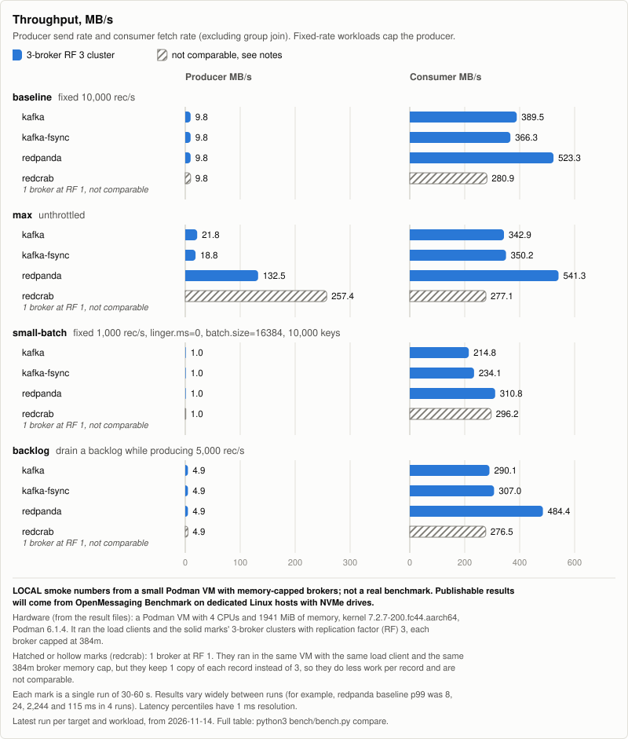

# redcrab

redcrab is a streaming broker that speaks the Apache Kafka wire protocol. It is written from scratch in Rust
and ships as a single binary, with no JVM and no ZooKeeper. It is tested with the stock Apache Kafka Java
command-line tools. The project started after the `redpanda-data/redpanda` repository was archived on GitHub (its last
GitHub release was v26.2.2). redcrab is a clean-room implementation, not a port. It is written from the public Kafka
protocol documentation, plus the Raft paper for the upcoming replication work, and it contains no source code from
Redpanda or Apache Kafka. The benchmark against Kafka and Redpanda is the project's most important deliverable,
and it was built before the broker.

> [!WARNING]
> **Status: pre-alpha. Single node only. Not for production.**
> redcrab runs as one node and does not replicate data. There is no redundancy: if the disk or the host is lost,
> the data is lost. It has no TLS, no authentication and no authorization. A known parsing issue means a large crafted
> request can still crash it on Linux (see [Security and known issues](#security-and-known-issues)). Do not put
> production data on it, and do not expose it to untrusted networks. It has been tested on macOS and, in the benchmark harness, in a Linux arm64 container.

## Contents

- [Features](#features)
- [Quickstart](#quickstart)
- [Configuration](#configuration)
- [Kafka API compatibility](#kafka-api-compatibility)
- [Benchmark](#benchmark)
- [Migrating from Apache Kafka](#migrating-from-apache-kafka)
- [Migrating from Redpanda](#migrating-from-redpanda)
- [Architecture](#architecture)
- [Development](#development)
- [Security and known issues](#security-and-known-issues)
- [Roadmap](#roadmap)
- [Contributing](#contributing)
- [License](#license)

## Features

### Works today

- **A single-node broker** with one plaintext TCP listener that speaks the Kafka protocol.
- **Topics:** create, delete, list and describe them, by name or by topic id. A topic can have 1 to 10,000
  partitions. Topics are never created automatically.
- **Produce** with `acks=0`, `acks=1` and `acks=all`. With `acks=1` and `acks=all`, a batch is fsynced to disk
  before it is acknowledged. Appends that arrive at a partition while an fsync is running share the next fsync
  (group commit). `acks=0` requests take the same write path but get no response.
- **Fetch** with long polling (`fetch.max.wait.ms` and `fetch.min.bytes` are honoured). Consumers only ever see
  data that has already been fsynced.
- **ListOffsets** for the earliest offset, the latest offset and lookups by timestamp.
- **Classic consumer groups:** join, sync, heartbeat and leave. The group rebalances when a member joins, leaves or
  lets its session expire. Committed offsets are fsynced before the commit is acknowledged, and they survive
  `kill -9`.
- **Storage:** a segmented log on disk with a sparse index. CRC-32C is checked on every produced batch and on the
  batches scanned during crash recovery. Recovery truncates a torn tail. If an fsync fails, that
  partition's log refuses further writes until the broker restarts.
- **Tested end to end** with the stock Apache Kafka 4.4.0 Java command-line tools: `kafka-topics`,
  `kafka-producer-perf-test`, `kafka-console-consumer`, `kafka-consumer-perf-test` and `kafka-consumer-groups`.
- **61 automated tests**, and the code is clean under Clippy, including the pedantic lints.

### Not yet

| Capability | Status today |
| --- | --- |
| Replication and clustering | Not implemented. This is the next major milestone (Raft per partition). Today there is a single copy of the data, and the replication factor must be 1. |
| Idempotent producer de-duplication | Producer ids are issued, but sequence numbers are not checked. A retried batch can be stored twice. |
| Transactions and exactly-once | Not supported. Transactional producers are refused. |
| KIP-848 consumer protocol (`group.protocol=consumer`) | Not supported. Use the classic protocol, which is the default in the Kafka 4.4.0 Java client. |
| Static group membership (`group.instance.id`) | Accepted but not honoured. Static members rejoin as dynamic members. |
| Fetch sessions (KIP-227) | Not supported. redcrab never creates a session, so clients send full fetch requests. |
| Topic configs | Accepted when a topic is created, then ignored. `DescribeConfigs` returns no entries, and configs cannot be altered. |
| Retention and compaction | Not implemented. Data is never deleted, except by deleting the whole topic. |
| Adding partitions, deleting records, deleting groups, altering configs | These APIs are not implemented. |
| TLS, SASL, ACLs, quotas | Not implemented. Any client that can connect has full access. |
| Metrics | None. The only output is the log. |
| Tiered storage, schema registry, HTTP proxy | Not implemented. |
| Platforms | Tested on macOS and, in the benchmark harness and the test suite, in a Linux arm64 container. Linux is the target platform; it has not been run on dedicated Linux hosts or on x86-64. Windows is not supported, because the storage layer uses Unix file APIs. |

## Quickstart

There are no prebuilt binaries or container images yet. You build redcrab from source.

### Build and run

You need a Rust toolchain that supports edition 2024 (`Cargo.toml` declares `rust-version = "1.89"`).

```sh
git clone https://github.com/Shindora/redcrab.git
cd redcrab
cargo build --release
./target/release/redcrab
```

With no flags, redcrab listens on `0.0.0.0:9092`, tells clients to connect to `127.0.0.1:9092`, and stores data
in `./redcrab-data`. It logs to stderr, starting with a line like this:

```text
INFO redcrab: listening local=0.0.0.0:9092 advertised=127.0.0.1:9092
```

Stop it with Ctrl-C. Every write acknowledged with `acks=1` or `acks=all` is already on disk, so an abrupt stop
loses nothing that was acknowledged.

### Clients and the advertised address

A Kafka client uses `bootstrap.servers` only for its first connection. After that, it connects to the host and
port that the broker advertises in its `Metadata` and `FindCoordinator` responses. redcrab advertises
`--advertised-host` (default `127.0.0.1`) and `--advertised-port` (default: the port it listens on).

Inside a container, `127.0.0.1` is the container itself. So when the clients run in a container, start redcrab
with an advertised host that resolves to your machine from inside the container:

```sh
# Podman
./target/release/redcrab --advertised-host host.containers.internal

# Docker Desktop
./target/release/redcrab --advertised-host host.docker.internal
```

For clients on other machines, advertise a DNS name or IP address that those machines can reach. redcrab has one
listener and advertises one address, so every client must be able to use that same address.

### Create a topic, produce and consume with stock Kafka tools

The examples below run the Apache Kafka command-line tools from the official `apache/kafka` image with Podman,
and they assume redcrab was started with `--advertised-host host.containers.internal`. For Docker Desktop,
replace `podman` with `docker` and `host.containers.internal` with `host.docker.internal`. If you have a local
Kafka distribution, you can run the same scripts directly with `localhost:9092`, against a redcrab started with
the default advertised host.

```sh
kafka_cli() { podman run --rm -i docker.io/apache/kafka:4.4.0 "$@"; }

kafka_cli /opt/kafka/bin/kafka-topics.sh --bootstrap-server host.containers.internal:9092 \
  --create --topic demo --partitions 3 --replication-factor 1

kafka_cli /opt/kafka/bin/kafka-topics.sh --bootstrap-server host.containers.internal:9092 --list
kafka_cli /opt/kafka/bin/kafka-topics.sh --bootstrap-server host.containers.internal:9092 --describe --topic demo

printf 'hello\nfrom\nredcrab\n' | kafka_cli /opt/kafka/bin/kafka-console-producer.sh \
  --bootstrap-server host.containers.internal:9092 --topic demo

kafka_cli /opt/kafka/bin/kafka-console-consumer.sh --bootstrap-server host.containers.internal:9092 \
  --topic demo --group demo-group --from-beginning --max-messages 3

kafka_cli /opt/kafka/bin/kafka-consumer-groups.sh --bootstrap-server host.containers.internal:9092 \
  --describe --group demo-group

kafka_cli /opt/kafka/bin/kafka-topics.sh --bootstrap-server host.containers.internal:9092 --delete --topic demo
```

The consumer may print the records in a different order, because records on different partitions have no
ordering relative to each other. The replication factor must be 1 (leaving it unset also works). Any other
value is rejected with `INVALID_REPLICATION_FACTOR`.

### Using a Kafka client library

Point `bootstrap.servers` at redcrab's advertised address (for example `127.0.0.1:9092`). Before you start, create
your topics, keep the replication factor at 1, and use the classic consumer group protocol. Other Kafka client
libraries connect the same way, but only the Apache Kafka 4.4.0 Java clients have been tested so far. If you hit
a problem with another client, please report it.

## Configuration

redcrab is configured only with command-line flags. There is no configuration file.

| Flag | Default | Description |
| --- | --- | --- |
| `--listen <ip:port>` | `0.0.0.0:9092` | Address to bind. It must be an IP address and port. Hostnames are not accepted. |
| `--advertised-host <host>` | `127.0.0.1` | Host that clients are told to connect to, in `Metadata` and `FindCoordinator` responses. |
| `--advertised-port <port>` | the port bound by `--listen` | Port that clients are told to connect to. |
| `--data-dir <path>` | `redcrab-data` (relative to the working directory) | Directory for the topic registry, the partition logs and committed offsets. It is created if it is missing. |
| `--node-id <int>` | `0` | Broker id reported in metadata. |

Every flag takes a value. An unknown flag, a missing value or an invalid value prints the usage line and exits
with status 1. There is no `--help` flag.

Logging goes to stderr. Set `RUST_LOG` to a single level (`error`, `warn`, `info`, `debug` or `trace`; the default
is `info`). Anything else, including per-module filters, falls back to `info`. At `debug`, every request is logged
with its API key, version and client id.

### Built-in limits

These values are fixed in the code and cannot be configured yet.

| Limit | Value |
| --- | --- |
| Request size | 100 MiB per request frame. A larger size prefix closes the connection. |
| In-flight requests | 32 per connection. |
| Partitions per topic | 1 to 10,000. |
| Topic names | 1 to 249 characters from `[a-zA-Z0-9._-]`, and not `.` or `..`. |
| Log segment size | 1 GiB. A new segment starts once the active one reaches this size. |
| Sparse index interval | About one index entry per 4 KiB of log. |
| Consumer group id | At most 120 bytes. |
| Session timeout | At most 30 minutes. |
| Offset commit metadata | At most 4096 bytes. |

## Kafka API compatibility

redcrab implements the APIs below, and its `ApiVersions` response advertises exactly these version ranges. Clients
negotiate down to them automatically.

| Key | API | Versions | Notes |
| ---: | --- | --- | --- |
| 0 | Produce | 3–13 | `acks` 0, 1 and -1. Only v2 record batches are accepted, and their CRC-32C is checked. From v13, topics are addressed by id. |
| 1 | Fetch | 4–18 | Sessionless only. Long polling. Reads stop at the high watermark, so only fsynced data is returned. |
| 2 | ListOffsets | 1–6 | Earliest, latest and timestamp lookups. Capped at v6, so max-timestamp lookups are not available. |
| 3 | Metadata | 0–13 | Always reports this single broker. Topics are never auto-created. |
| 8 | OffsetCommit | 2–9 | Offsets are fsynced before the response is sent. |
| 9 | OffsetFetch | 1–9 | |
| 10 | FindCoordinator | 0–6 | Group coordinators only. Transaction coordinator lookups are refused. |
| 11 | JoinGroup | 0–9 | Classic protocol. `group.instance.id` is echoed back but not honoured. |
| 12 | Heartbeat | 0–4 | |
| 13 | LeaveGroup | 0–5 | |
| 14 | SyncGroup | 0–5 | |
| 15 | DescribeGroups | 0–6 | |
| 16 | ListGroups | 0–5 | Supports the state and type filters. |
| 18 | ApiVersions | 0–4 | A request at a newer version gets a v0 reply, so the client downgrades. |
| 19 | CreateTopics | 2–7 | The replication factor must be 1 or -1. Configs are ignored. `validate_only` is supported. |
| 20 | DeleteTopics | 1–6 | By name, or by topic id from v6. |
| 22 | InitProducerId | 0–5 | Non-transactional producers only. Ids are issued, but sequence numbers are not checked. |
| 32 | DescribeConfigs | 1–4 | Topics and the broker. Every config list comes back empty. |

Every other API is unimplemented, and requests for one are logged at `warn` as `unsupported request`. For a few of
them, redcrab replies with an `UNSUPPORTED_VERSION` error (`SaslHandshake`, `SaslAuthenticate`, `DescribeCluster`,
`ConsumerGroupHeartbeat`, `AddOffsetsToTxn`, `EndTxn`, `GetTelemetrySubscriptions`, `PushTelemetry`). Any other
unimplemented request, and any version outside the ranges above, closes the connection. Clients that read
`ApiVersions` first do not send APIs or versions that the broker does not advertise.

## Benchmark

The benchmark against Apache Kafka and Redpanda is treated as the project's most important deliverable, and it
was built before the broker. Its goal is to produce numbers that anyone can reproduce, comparing the systems under
the same durability guarantees.

No benchmark results have been published yet. The charts below come from the local harness.

> [!WARNING]
> These charts show a local smoke test, not a benchmark, and they are not a fair comparison.
>
> - Kafka, Kafka with `flush.messages=1` and Redpanda ran as 3-broker clusters with replication factor 3, inside a
>   4-CPU Podman VM with about 2 GiB of memory on a laptop, with each broker container capped at 384 MiB.
> - redcrab ran as one node with replication factor 1, because it has no replication yet. It ran in the same VM,
>   driven by the same client containers, with the same 384 MiB container cap. It keeps one copy of each record
>   where the others keep three, so it does less work per record, and its hatched bars and hollow dots cannot be
>   compared with the other three.
> - Each value is a single run of 30 to 60 seconds. Results vary a lot from run to run, and latency percentiles
>   have 1 ms resolution.
>
> Publishable results will come from [OpenMessaging Benchmark](#openmessaging-benchmark) runs on dedicated Linux
> hosts with NVMe drives. Each chart repeats these caveats in its caption.

<picture>
  <source media="(prefers-color-scheme: dark)" srcset="bench/charts/latency-dark.svg">
  
</picture>

<picture>
  <source media="(prefers-color-scheme: dark)" srcset="bench/charts/throughput-dark.svg">
  
</picture>

The harness writes the numbers behind the charts to `bench/results/`, which is not committed. `python3 bench/bench.py compare` prints them as a table, and
`python3 bench/bench.py chart` redraws the charts.

### Fairness rules

- **Same client, same settings.** Every system is driven by the same Kafka client: the perf tools from one pinned
  `apache/kafka:4.4.0` image in the local harness, and the same Kafka driver in OpenMessaging Benchmark. Producer
  and consumer settings are identical for every system.
- **Replication factor 3, `acks=all`, `min.insync.replicas=2`** on every system. redcrab is the exception until it has
  replication: it runs as one node with replication factor 1 and `min.insync.replicas=1`, and is marked as not
  comparable for that reason.
- **Kafka is measured in two modes.** The first is Kafka's default, which does not fsync before acknowledging.
  The second sets `flush.messages=1`, which fsyncs every append before acknowledging. The local harness sets this
  broker-wide as `log.flush.interval.messages=1`, and the OMB driver sets it as a topic config. Redpanda and
  redcrab both fsync before acknowledging, so the `flush.messages=1` run is the like-for-like comparison. The
  default run is included because it is Kafka's default configuration.
- **Redpanda runs with write caching disabled.** The local harness sets `write_caching_default=false` and reads it
  back; the OMB driver also sets the topic config `write.caching=false`.
- **The settings in effect are recorded.** Each local result file records the producer acks and Kafka's broker
  flush setting, plus the Redpanda write-caching value and the effective topic configs as read back from the
  cluster.
- **Published numbers come from long runs on pre-filled disks**, so they reflect steady state rather than an
  empty drive.

### Workloads

Every workload uses 1 KiB records, 100 partitions, replication factor 3, `acks=all` and `min.insync.replicas=2`
(replication factor 1 and `min.insync.replicas=1` for redcrab).
The producer uses `linger.ms=1` and `batch.size=131072`, except in small-batch. The consumer uses
`fetch.max.bytes=16777216`.

| Workload | Shape | Local harness | OMB workload file |
| --- | --- | --- | --- |
| `baseline` | Fixed-rate open loop. | 10,000 records/s. | 50,000 msg/s. |
| `max` | Highest sustainable throughput. | Unthrottled. A 15 s probe measures the rate, which sets how many records the run sends. | `producerRate: 0`, so OMB searches for the maximum rate. |
| `small-batch` | `linger.ms=0`, `batch.size=16384`, random keys. | 1,000 records/s over 10,000 keys. | 10,000 msg/s. |
| `backlog` | Consumers drain a backlog while producers keep writing. | Pre-fills 50,000 × `--seconds` records unthrottled, then drains them from the start while a producer writes 5,000 records/s. | 50 GB backlog, 50,000 msg/s. |

The OMB workload files use 4 producers and 4 consumers, a 5-minute warm-up and a 15-minute measured run.

### Metrics

- Producer throughput, in records/s and MB/s.
- Producer latency from send to acknowledgement with `acks=all`: average, p50, p95, p99, p99.9 and max, measured
  at steady state with the warm-up excluded.
- Consumer throughput, in records/s and MB/s, excluding the time spent joining the group.
- For `backlog`: the drain rate while the live producer keeps writing.
- Broker memory after the load (local harness only).

### Running the local harness

You need Python 3.11 or newer, Podman with a working `podman compose`, and both images pinned at the top of
`bench/bench.py` (`KAFKA_IMAGE` and `REDPANDA_IMAGE`), pulled before you start. The `redcrab` target also needs the
Rust toolchain from [Build and run](#build-and-run) with the static Linux target for the CPU of your Podman VM:
`rustup target add aarch64-unknown-linux-musl` on Apple silicon, or `x86_64-unknown-linux-musl` on x86-64.

```sh
python3 bench/bench.py run <target> <workload> [--seconds 60] [--partitions 100]
python3 bench/bench.py compare
python3 bench/bench.py chart
```

- Targets: `kafka`, `kafka-fsync` (Kafka with `flush.messages=1`), `redpanda` and `redcrab`.
- Workloads: `baseline`, `max`, `small-batch` and `backlog`.
- `--seconds` is the number of measured seconds per phase. `baseline` and `small-batch` also run a 60 s warm-up
  that is left out of the summary, and `max` leaves out the first sixth of its run.

A run does the following:

1. Starts a 3-broker cluster from `bench/kafka.yml` (KRaft, with combined broker and controller nodes) or from
   `bench/redpanda.yml`. For `redcrab`, it starts one broker from `bench/redcrab.yml` instead (see below).
2. Waits for the brokers. For Redpanda, it also turns write caching off and reads the value back. Then it
   creates the topic and records its effective configs.
3. Drives the load with `kafka-producer-perf-test` and `kafka-consumer-perf-test` from throwaway client
   containers.
4. Tears the cluster down along with its volumes.
5. Writes `bench/results/<utc-timestamp>-<target>-<workload>.json`.

`compare` prints one table with the latest result for each target and workload. `chart` draws the same results
as SVG charts in `bench/charts/`, one light and one dark file per chart, with the caveats from the result files in
each caption. It marks a run as not comparable when it did not use a 3-broker cluster with replication factor 3,
when its brokers were not capped at 384 MiB, or when the harness did not start the broker. A `max` run can write
tens of gigabytes inside the Podman VM.

For `redcrab`, the harness first builds the broker from this checkout on your machine, not inside the small VM.
`cargo build --release --target <arch>-unknown-linux-musl` produces a static Linux binary linked against musl, so
it uses musl's memory allocator. It links with the `rust-lld` that ships with Rust, so no C toolchain is needed.
`podman build` then packages it with `bench/Containerfile` as the image `localhost/redcrab-bench:latest`. Both
steps are quick no-ops when nothing changed. The run starts that image as one broker, `bench-1`, on the same
network as the other clusters, with the same 384 MiB container cap and its data on a volume. It creates the topic
with replication factor 1 and `min.insync.replicas=1`, and it is driven by the same client containers. The result
file records the image id, the git commit, the Rust target and the SHA-256 of the binary.

Replication factor 1 is the default for `redcrab` and the only value it accepts today. A redcrab run therefore
keeps one copy of each record, while the Kafka and Redpanda runs replicate each record to three brokers. That makes
redcrab runs non-comparable with theirs. Until replication lands, they are useful for development only.

To benchmark a redcrab that you started yourself, pass its address with `--bootstrap` (and, if needed,
`--replication-factor`). Use a fresh data directory for each run, because the harness creates the topic `bench`
and does not delete it:

```sh
./target/release/redcrab --listen 0.0.0.0:19092 --advertised-host host.containers.internal --data-dir "$(mktemp -d)"
python3 bench/bench.py run redcrab baseline --bootstrap host.containers.internal:19092
```

The charts mark such runs as not started by the harness. A broker on the macOS host also runs on different
resources: there `fsync` uses `F_FULLFSYNC`, which costs much more than `fdatasync` inside the VM, and the clients
reach it over the slower network path between the VM and the host.

> [!NOTE]
> Results from the local harness are smoke tests, not benchmark results. The harness runs memory-capped brokers
> (384 MiB containers, a 128 MiB Kafka heap, and Redpanda limited to one core and 256 MiB) inside a small Podman
> VM on a laptop. Every result file says so in its `note` field. Use them to check that the harness and the
> systems work, not to compare performance, and do not quote them as benchmark results.

### OpenMessaging Benchmark

Published numbers will come from [OpenMessaging Benchmark](https://github.com/openmessaging/benchmark) runs on
dedicated Linux hosts with NVMe drives. The configuration files are in `bench/omb/`:

- `bench/omb/drivers/` has one driver per system (`kafka`, `kafka-fsync`, `redpanda`, `redcrab`), plus a
  `*-small-batch` variant of each with the small-batch producer settings.
- `bench/omb/workloads/` has `baseline`, `max`, `small-batch` and `backlog`.

Run `small-batch` with the `*-small-batch` drivers and the other workloads with the plain drivers. The driver
files ship with `bootstrap.servers=localhost:9092` as a placeholder, so set it to the cluster under test. For
Redpanda, also confirm that `rpk cluster config get write_caching_default` prints `false`. The redcrab drivers use
replication factor 3 like the others, so they cannot be used until replication lands.

## Migrating from Apache Kafka

> [!IMPORTANT]
> redcrab is a pre-alpha, single-node broker with no replication, so moving production traffic to it is not
> recommended yet. This section shows how to evaluate redcrab against an existing Kafka workload today, and
> outlines what the migration path is expected to be once replication is available.

### 1. Check what the workload depends on

A workload is a candidate for evaluation only if it does not depend on any of the following:

- More than one broker, a replication factor above 1, rack awareness, or any form of failover.
- Transactions or exactly-once processing, such as `transactional.id` or Kafka Streams with
  `processing.guarantee=exactly_once_v2`.
- Retries that never produce duplicates. Idempotent producers start, but duplicates are not removed.
- The KIP-848 consumer protocol (`group.protocol=consumer`) or static membership (`group.instance.id`).
- Topic configs such as `retention.ms`, `retention.bytes`, `cleanup.policy=compact`, `max.message.bytes` or
  `min.insync.replicas`. They are accepted and ignored, so nothing is ever deleted or compacted.
- Topic auto-creation.
- Admin operations beyond creating, deleting, listing and describing topics, and listing and describing groups.
  That rules out adding partitions, altering configs, deleting records, deleting groups, ACLs, quotas and
  partition reassignment.
- TLS, SASL or ACLs.
- Broker metrics.
- Tools that have not been tested with redcrab. Kafka Connect, MirrorMaker 2, Kafka Streams and Schema Registry
  are all untested.

### 2. Adjust the client configuration

| Setting | On redcrab |
| --- | --- |
| `bootstrap.servers` | redcrab's advertised address. For plain producers and consumers, this is usually the only change. |
| `security.protocol` | `PLAINTEXT` only. Remove any SSL and SASL settings. |
| `acks` | `0`, `1` and `all` all work. Today `1` and `all` mean the same thing: the batch is fsynced on the single node. There are no replicas. |
| `enable.idempotence` | The default (`true`) works, but duplicates caused by retries are not removed. |
| `transactional.id` | Not supported. Transactional producers fail when they initialize transactions. |
| `group.protocol` | `classic`, which is the default in the Kafka 4.4.0 Java client. `consumer` is not supported. |
| `group.instance.id` | Ignored. The consumer behaves as a dynamic member. |
| `isolation.level` | No effect. There are no transactions, so `read_committed` returns the same data as `read_uncommitted`. |
| `allow.auto.create.topics` | No effect. redcrab never creates topics automatically. |

### 3. Create the topics

Create each topic with the same name and partition count it has on the source cluster, and a replication factor
of 1:

```sh
kafka-topics.sh --bootstrap-server <redcrab-host>:9092 --create --topic orders --partitions 12 --replication-factor 1
```

### 4. Copy data for the evaluation

Committed consumer offsets do not carry over. Offsets on redcrab start at 0, so consumer groups on redcrab should
start from the earliest offset.

For text data, you can pipe the stock console consumer into the stock console producer. Both tools separate the
key from the value with a tab by default. The null marker keeps null keys and values null instead of turning
them into the string `null`:

```sh
kafka-console-consumer.sh --bootstrap-server <kafka-host>:9092 --topic orders --from-beginning --timeout-ms 30000 \
    --formatter-property print.key=true --formatter-property null.literal=__NULL__ \
  | kafka-console-producer.sh --bootstrap-server <redcrab-host>:9092 --topic orders \
    --reader-property parse.key=true --reader-property null.marker=__NULL__
```

The consumer exits after 30 seconds without new records, and the producer then flushes and exits. To keep copying
new records as they arrive, leave out `--from-beginning` and `--timeout-ms`. Each tool can also run from the
`apache/kafka` image, as in the quickstart. The flag names above are from Kafka 4.4.0. The pipe has limits:

- It works line by line. A value that contains a newline, a key that contains a tab, or binary data will not copy
  correctly.
- Record headers and timestamps are not preserved.
- Records are partitioned again by the console producer's default partitioner, so the partition a key lands on
  can differ from the source.

For binary data, headers, timestamps or exact partition placement, write a short program with any Kafka client
library. It should consume from the source and produce to redcrab, copying the key, value, headers and timestamp
of each record and sending each record to the same partition number it came from.

### 5. Run the workload

Point a staging copy of the producers and consumers at redcrab, then watch two places:

- The client logs, for `UnsupportedVersionException` and similar errors. They mean the client needs an API that
  redcrab does not implement. Check the [compatibility table](#kafka-api-compatibility).
- The redcrab log. Unimplemented requests are logged at `warn` as `unsupported request`, with the API key and
  version. With `RUST_LOG=debug`, every request is logged.

### Planned migration path

This depends on replication (milestone M3) and is subject to change. Once redcrab can run as a replicated cluster,
the expected path is:

1. Run a redcrab cluster with replication factor 3 alongside the existing cluster.
2. Create the topics with matching partition counts.
3. Keep the data flowing from the source cluster to redcrab. Whether MirrorMaker 2 can be used for this will be
   tested at that point.
4. Move consumers first, then producers. Offsets differ between the two clusters, so consumer positions have to be
   re-established. How redcrab will support that has not been decided.
5. Keep the source cluster until the switch has been verified.

This section will be updated as replication lands.

## Migrating from Redpanda

> [!IMPORTANT]
> redcrab is a pre-alpha, single-node broker with no replication, so moving production traffic to it is not
> recommended yet. This section shows how to evaluate redcrab against an existing Redpanda workload today, and
> outlines what the migration path is expected to be once replication is available.

Redpanda and redcrab both speak the Kafka protocol, so the client-side steps are the same as for
[Apache Kafka](#migrating-from-apache-kafka): check the dependency list, change `bootstrap.servers`, create the
topics with replication factor 1, copy data with the stock Kafka tools, and run the workload. The stock Kafka
tools work against Redpanda as the source; the local benchmark harness drives Redpanda with them. The rest of
this section covers what is different.

### What has no equivalent yet

redcrab only speaks the Kafka protocol, on a single port.

| Redpanda feature | redcrab today |
| --- | --- |
| Raft replication (replication factor 3) | Not yet. This is milestone M3. |
| Tiered storage | Not implemented. |
| HTTP proxy | Not implemented. |
| Built-in schema registry | Not implemented. Clients that use a schema registry need a separate registry service; none has been tested with redcrab. |
| Data transforms | Not implemented. |
| Admin API | Not implemented. |
| `rpk` | Untested. Commands that go through the Redpanda Admin API cannot work. Commands that use the Kafka protocol have not been tested. |
| Redpanda Console | Untested. |
| Topic properties such as `write.caching` and `redpanda.*` | Accepted at creation and ignored, like all topic configs. |

### Durability differences

On a Redpanda cluster with write caching off, `acks=all` waits for a Raft majority of replicas. On redcrab today,
`acks=1` and `acks=all` both mean that the batch has been fsynced on the one node, and nothing more. redcrab
always fsyncs before acknowledging; there is no setting that turns this off.

### Copying data

Use the console consumer and console producer pipe from the
[Kafka section](#4-copy-data-for-the-evaluation), with the Redpanda cluster as the source. Copying with `rpk`
(for example `rpk topic consume` piped into `rpk topic produce`) has not been tested against redcrab.

### Planned migration path

The path is the same as the [planned path from Kafka](#planned-migration-path), and it also depends on
replication (M3). Workloads that rely on tiered storage, the HTTP proxy, the built-in schema registry or data
transforms need those to be replaced by other components first. None of them is on the roadmap today.

## Architecture

redcrab is a library (`src/lib.rs`) plus a small binary (`src/main.rs`). It runs on a multi-threaded Tokio runtime.
Each connection has a reader task and a writer task, and disk I/O runs on Tokio's blocking thread pool.

```text
client ── TCP ──> server.rs   frames, decodes and version-checks requests; writes responses in request order
                     │
                     └──> api.rs   one handler per Kafka API
                            ├──> broker.rs    topic registry, partitions, group-commit write path
                            │       └──> storage.rs   segmented partition log on disk
                            └──> group.rs     classic consumer groups, committed offsets
```

### Produce path

1. `server.rs` reads a size-prefixed request frame (100 MiB at most), decodes the header and checks the API
   version against the table in `api.rs`.
2. `api::produce` resolves each partition and splits the payload into v2 record batches, checking the framing and
   CRC-32C of each one. The batches are queued on the partition before the next request is read, so request order
   is append order.
3. Each partition has at most one commit task, which runs on the blocking pool (`broker.rs`). It takes every queued
   append, writes them to the log (assigning offsets by rewriting each batch's base offset in place), and calls a
   single fsync for the whole group. Once the fsync succeeds, it advances the partition's high watermark, wakes any
   waiting fetches and completes the appends. Appends that arrive during an fsync go into the next round.
4. The produce response completes when all of its partitions have been flushed. The connection's writer task
   sends responses strictly in request order. `acks=0` requests follow the same path but get no response.

### Fetch path

1. `api::fetch` accepts sessionless fetches only and resolves topics by name, or by id from v13.
2. If any partition has data past its fetch offset, if `min_bytes` is 0, or if the wait has expired, it reads the
   partitions on the blocking pool. Each read returns whole batches, starting with the batch that contains the
   fetch offset, and stays within the partition and response byte limits. The first non-empty partition always
   returns at least one batch, so the consumer makes progress.
3. Reads are cut at the high watermark, which only moves after an fsync. That is why consumers never see
   unflushed data.
4. Otherwise the fetch waits for the next flush on any partition, or for `max_wait_ms`, and tries again.

### Consumer groups

`group.rs` implements the classic group protocol, and this node coordinates every group. Group membership lives in
memory only: after a restart, members rejoin. A timer in the accept loop checks session and rebalance timeouts
every 100 ms. Committed offsets are written durably before the commit is acknowledged.

### On-disk layout

```text
<data-dir>/
├── topics                          topic registry: one line per topic, "<topic-id>\t<partitions>\t<name>"
├── <topic-id>/                     one directory per topic, named by its UUID
│   └── <partition>/                one directory per partition: 0, 1, 2, ...
│       ├── 00000000000000000000.log     record batches, byte for byte as produced (base offset assigned)
│       └── 00000000000000000000.index   sparse index: 16-byte big-endian entries
└── groups/
    └── <hex-encoded group id>      committed offsets: "<topic>\t<partition>\t<offset>\t<leader epoch>\t<metadata>"
```

- **Segments.** Each segment is named after its base offset, zero-padded to 20 digits. A segment rolls at 1 GiB.
  Each index entry holds a relative offset (u32), a file position (u32) and the largest batch timestamp before
  that position (i64).
- **Index ordering.** Index entries reach the index file only after the log bytes they cover have been synced, so
  every entry on disk marks a point up to which the log is known to be durable.
- **Recovery.** On startup, only the active segment needs recovery, because sealed segments are fully synced
  before a new segment is rolled. The active segment is checked from its last durable index entry onwards, batch
  by batch, and the first torn or corrupt batch and everything after it are truncated.
- **Metadata files.** The topic registry and the committed-offset files are replaced atomically: written to a
  temporary file, fsynced, renamed over the old file, and then the directory is fsynced.
- **fsync calls.** Log flushes use `fdatasync` on Linux. On macOS, the Rust standard library issues
  `fcntl(F_FULLFSYNC)`, which also drains the drive's write cache.
- **Failed writes.** After a failed write or fsync, a log refuses further writes until the broker restarts,
  because a later successful fsync would not prove that the earlier data reached the disk.

## Development

```sh
cargo build --release        # build target/release/redcrab
cargo test                   # unit tests plus end-to-end tests over TCP (61 today)
cargo clippy --all-targets   # Clippy all + pedantic lints are enabled in Cargo.toml
cargo fmt --check            # formatting
```

The benchmark harness needs Python 3.11 or newer and Podman; see [Running the local harness](#running-the-local-harness).

### Project layout

| Path | Contents |
| --- | --- |
| `src/main.rs` | Command-line parsing and process startup. |
| `src/lib.rs` | Library root. |
| `src/server.rs` | TCP accept loop, request framing, in-order response writing, group timeout timer. |
| `src/api.rs` | One handler per Kafka API, and the advertised version table. |
| `src/broker.rs` | Topic registry, partitions, group-commit write path. |
| `src/group.rs` | Classic consumer group coordinator and durable committed offsets. |
| `src/storage.rs` | Segmented partition log, sparse index, crash recovery. |
| `tests/roundtrip.rs` | End-to-end tests against a broker over TCP. |
| `bench/bench.py` | Local benchmark harness. |
| `bench/kafka.yml`, `bench/redpanda.yml` | Compose files for the 3-broker clusters used by the harness. |
| `bench/redcrab.yml`, `bench/Containerfile` | Compose file for the single redcrab broker, and the image the harness builds around a static Linux binary. |
| `bench/auth.json` | Empty registry credentials file that the harness points Podman at. |
| `bench/charts/` | Comparison charts drawn by `bench.py chart`, in light and dark versions. |
| `bench/omb/` | OpenMessaging Benchmark driver and workload files. |

## Security and known issues

> [!CAUTION]
> Do not expose redcrab to untrusted networks.

- **No TLS, SASL or ACLs.** Anyone who can reach the port can read and write every topic, and can create and
  delete topics. The default `--listen 0.0.0.0:9092` binds every interface. When every client runs on the same
  host, use `--listen 127.0.0.1:9092`. Clients in containers may not be able to reach a loopback address.
- **A large crafted request can still crash the broker on Linux.** The 0.18.0 release of the `kafka-protocol`
  crate sized arrays from a length prefix taken from the untrusted request, so a request of a few bytes aborted
  the process on Linux. redcrab now pins the crate to an unreleased upstream commit (`37fed76`), which rejects
  array, string and byte lengths larger than the rest of the request. Tests in a Linux arm64 container check that
  such a request now only closes its connection. The crate still reserves memory for an array before decoding it,
  up to 120 bytes per byte of request, so a crafted request of tens of MiB can abort the process on a Linux host
  whose RAM plus swap is smaller than that reservation: 27 MiB was enough on a host with 2 GiB of RAM and no swap.
  redcrab rejects frames larger than 100 MiB before reading them, which caps the reservation at about 12 GiB.
  Other Linux targets and overcommit settings are untested. redcrab will move to a crates.io release once one
  includes these fixes.
- **Retries can duplicate data.** A retried idempotent produce can be stored twice, because sequence numbers are
  not checked.
- **Producer ids are not persisted.** They are seeded from the wall clock at startup, so if the clock steps back
  across a restart, ids can be reused.
- **Disk usage only grows.** Data is never deleted until its topic is deleted.
- **Timestamp lookups are approximate.** `ListOffsets` by timestamp resolves to a batch boundary, and it returns
  the requested timestamp rather than the timestamp of the matched record.
- **Offset commits get slower with partition count.** Each group's offsets file is rewritten in full on every
  commit.
- **Long polls share one wake-up signal.** A single broker-wide flush signal wakes every waiting fetch.
- **There is no broker-wide memory budget.** In-flight requests are bounded only by count, at 32 per connection.

To report a security problem, open an issue that asks for a private contact, and leave the details out of it.

## Roadmap

| Milestone | Scope | Status |
| --- | --- | --- |
| M0 | Benchmark harness: the local harness for Kafka and Redpanda, OpenMessaging Benchmark configurations, and published results from dedicated Linux hosts. | In progress. The local harness exists. |
| M1 | Single-node broker. | Done. |
| M2 | Classic consumer groups. | Done. |
| M3 | Replication: Raft per partition, plus a controller group. | Next. |
| M4 | Performance work driven by profiles: thread-per-core, io_uring and O_DIRECT on Linux, retention, compaction. | Planned. |
| M5 | Idempotent producer de-duplication, then transactions. | Planned. |

Items under [Not yet](#not-yet) that are missing from this table, such as TLS, SASL, ACLs, metrics, the KIP-848
consumer protocol and topic configs, are not scheduled yet.

## Contributing

Issues and pull requests are welcome. Before you open a pull request, run `cargo fmt --check`,
`cargo clippy --all-targets` and `cargo test`, and make sure all three pass cleanly.

redcrab is a clean-room implementation. Contributions must not contain code that is copied from, translated from
or derived from the Redpanda or Apache Kafka brokers, and they should not be written while consulting that source.
Work from the public Kafka protocol documentation, KIPs and published papers. Running Kafka or Redpanda as black
boxes is fine, for example in the benchmark or to compare behaviour.

Changes to the benchmark must keep the [fairness rules](#fairness-rules).

## License

redcrab is released under the [MIT License](LICENSE).

Apache Kafka and Kafka are trademarks of The Apache Software Foundation, and Redpanda is a trademark of Redpanda
Data, Inc. They are used here only to describe compatibility and the benchmark. redcrab is an independent project
and is not affiliated with, endorsed by or sponsored by either organization.
