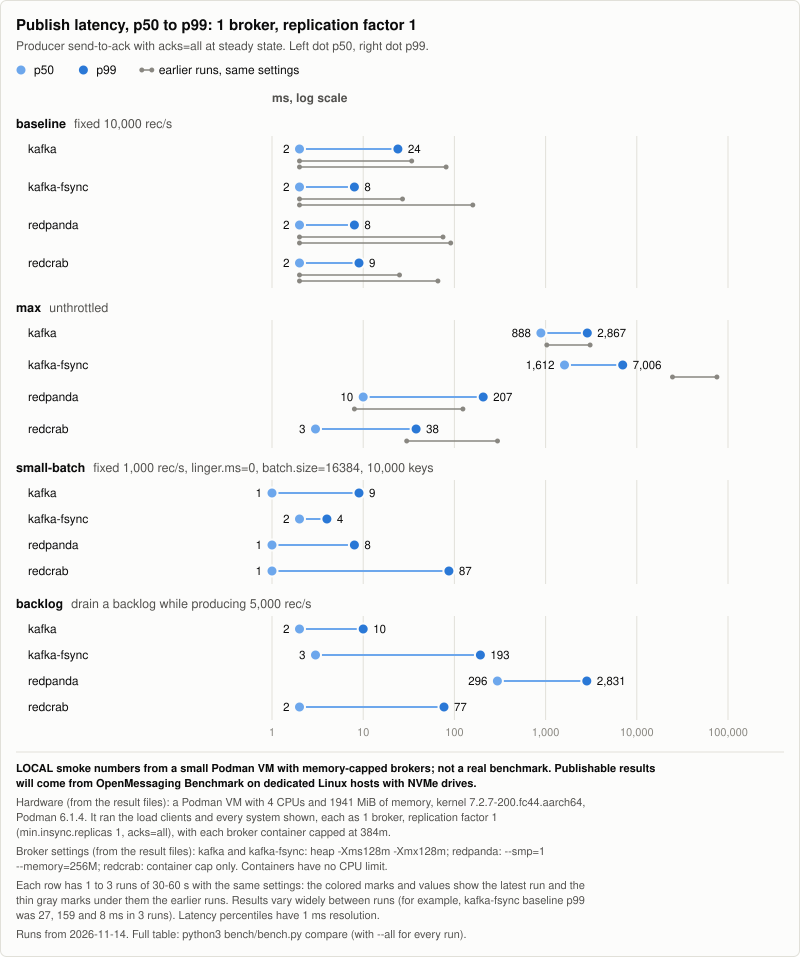
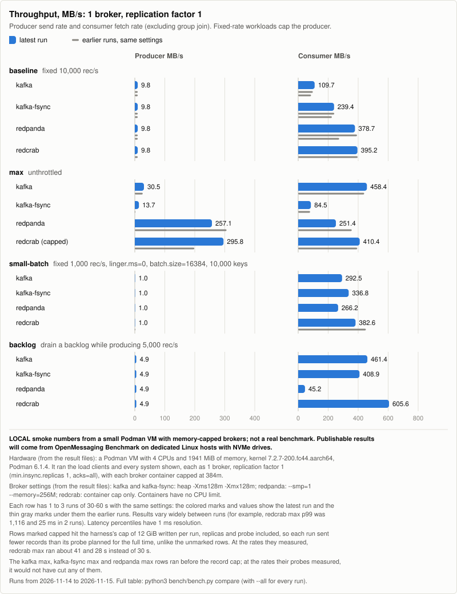

# redcrab

redcrab is a streaming broker that speaks the Apache Kafka wire protocol. It is written from scratch in Rust
and ships as a single binary, with no JVM and no ZooKeeper. It is tested with the stock Apache Kafka Java
command-line tools. The project started after the `redpanda-data/redpanda` repository was archived on GitHub
(its last GitHub release was v26.2.2). redcrab is a clean-room implementation, not a port. It is written from the
public Kafka protocol documentation, plus the Raft paper for replication, and it contains no source code from
Redpanda or Apache Kafka. The benchmark against Kafka and Redpanda is the project's most important deliverable,
and it was built before the broker.

> [!WARNING]
> **Status: pre-alpha. Not for production.**
> redcrab runs as a single node or as a cluster with a fixed set of nodes that replicates every partition with Raft.
> Replication is new: it has been tested only by the test suite and in a local Podman VM, including killing
> partition leaders and cutting brokers off the network under load. redcrab has no TLS, no authentication and no
> authorization, neither on the Kafka listener nor on the internal port that the nodes replicate over. A
> handful of connections sending large requests can still run it out of memory (see
> [Security and known issues](#security-and-known-issues)). Do not put production data on it, and do not expose it
> to untrusted networks.

## Features

### Works today

- **One node, or a cluster with a fixed set of nodes** named with `--peers` at the first start.
- **Raft replication:** one group per partition, plus one metadata group over every node whose leader is the
  controller. Each new leader writes a no-op control batch, so a partition's offsets are not contiguous.
- **Topics:** create, delete, list and describe, with 1 to 10,000 partitions and replication up to the node count.
- **Produce and fetch:** `acks=1` and `all` wait until a majority has fsynced; reads stop at the high watermark.
- **Classic consumer groups**, with committed offsets replicated through the metadata log.
- **Durable storage:** a segmented log with CRC-32C checks and crash recovery that truncates a torn tail.

### Not yet

| Capability | Status today |
| --- | --- |
| Membership changes | The set of nodes is fixed by `--peers` at the first start. Nodes cannot be added, removed or replaced, partitions cannot be moved, and leadership is not rebalanced after failures. |
| Retention, compaction and snapshots | Data is never deleted, except by deleting the whole topic, and the metadata log keeps every topic change and offset commit. Disk usage only grows, and every start replays the whole metadata log. |
| In-sync replicas | `Metadata` reports every replica as in sync. `min.insync.replicas` is ignored, and `acks=1` waits for a majority like `acks=all`. |
| Idempotence and transactions | Producer ids are issued, but sequence numbers are not checked, so a retried batch can be stored twice. Transactional producers are refused. |
| KIP-848, static membership, fetch sessions | Use the classic group protocol, the default in the Kafka 4.4.0 Java client. `group.instance.id` is accepted but not honoured. Fetch sessions (KIP-227) are never created. |
| Topic configs and other admin APIs | Configs are accepted at creation and ignored, and `DescribeConfigs` returns none. Adding partitions, deleting records, deleting groups and altering configs are not implemented. |
| TLS, SASL, ACLs, quotas, metrics | None. Any client that can connect has full access, the internal RPC port is not authenticated or encrypted, and the only output is the log. |
| Platforms | Tested on macOS and in Linux arm64 containers. Linux is the target, but redcrab has not been run on dedicated Linux hosts or on x86-64. Windows is not supported. |

## Quickstart

There are no prebuilt binaries or container images yet. You build redcrab from source.

### Build and run

You need a Rust toolchain that supports edition 2024 (`Cargo.toml` declares `rust-version = "1.89"`).

```sh
git clone https://github.com/Shindora/redcrab.git
cd redcrab
cargo build --release
./target/release/redcrab
```

With no flags, redcrab listens on `0.0.0.0:9092`, tells clients to connect to `127.0.0.1:9092`, and stores data
in `./redcrab-data`. It logs to stderr, starting with a line like this:

```text
INFO redcrab: listening local=0.0.0.0:9092 advertised=127.0.0.1:9092
```

Stop it with Ctrl-C or SIGTERM: it answers the requests it has already read for up to 5 seconds, fsyncs its logs
and exits with status 0. Every write acknowledged with `acks=1` or `acks=all` is already fsynced, so `kill -9` or a
crash loses nothing that was acknowledged.

Kafka clients use `bootstrap.servers` only for their first connection and then connect to the address that redcrab
advertises (`--advertised-host`, default `127.0.0.1`), so for clients in containers start it with
`--advertised-host host.containers.internal` (Podman) or `host.docker.internal` (Docker Desktop). Only the Apache
Kafka 4.4.0 Java clients have been tested so far, with the classic consumer group protocol.

### Create a topic, produce and consume with stock Kafka tools

These examples run the Kafka command-line tools from the official `apache/kafka` image with Podman, against a
redcrab started with `--advertised-host host.containers.internal`. For Docker Desktop, replace `podman` with
`docker` and `host.containers.internal` with `host.docker.internal`.

```sh
kafka_cli() { podman run --rm -i docker.io/apache/kafka:4.4.0 "$@"; }

kafka_cli /opt/kafka/bin/kafka-topics.sh --bootstrap-server host.containers.internal:9092 \
  --create --topic demo --partitions 3 --replication-factor 1

kafka_cli /opt/kafka/bin/kafka-topics.sh --bootstrap-server host.containers.internal:9092 --list
kafka_cli /opt/kafka/bin/kafka-topics.sh --bootstrap-server host.containers.internal:9092 --describe --topic demo

printf 'hello\nfrom\nredcrab\n' | kafka_cli /opt/kafka/bin/kafka-console-producer.sh \
  --bootstrap-server host.containers.internal:9092 --topic demo

kafka_cli /opt/kafka/bin/kafka-console-consumer.sh --bootstrap-server host.containers.internal:9092 \
  --topic demo --group demo-group --from-beginning --max-messages 3

kafka_cli /opt/kafka/bin/kafka-consumer-groups.sh --bootstrap-server host.containers.internal:9092 \
  --describe --group demo-group

kafka_cli /opt/kafka/bin/kafka-topics.sh --bootstrap-server host.containers.internal:9092 --delete --topic demo
```

The consumer may print the records in a different order, because records on different partitions are not ordered
relative to each other. On a single node, the replication factor must be 1 (or unset).

### Run a three-node cluster

Each node needs its own node id, Kafka listener, RPC listener and data directory. Every node gets the same
`--peers` list, which names every node of the cluster, itself included: its id, the address of its RPC listener,
and the Kafka address that clients are told to use. On one machine, with the clients in containers as above:

```sh
PEERS=1@127.0.0.1:19093/host.containers.internal:19092,2@127.0.0.1:29093/host.containers.internal:29092,3@127.0.0.1:39093/host.containers.internal:39092
for id in 1 2 3; do
  ./target/release/redcrab --node-id $id --listen 0.0.0.0:${id}9092 --rpc-listen 127.0.0.1:${id}9093 \
    --data-dir redcrab-data-$id --peers "$PEERS" &
done

kafka_cli /opt/kafka/bin/kafka-topics.sh --bootstrap-server host.containers.internal:19092 \
  --create --topic demo3 --partitions 6 --replication-factor 3
kafka_cli /opt/kafka/bin/kafka-topics.sh --bootstrap-server host.containers.internal:29092 --describe --topic demo3
```

The description shows three replicas per partition, with the leaders spread over the three nodes. The cluster
survives the loss of any one node, and a node started again with the same flags and data directory catches up on
its own. On separate hosts, give each node its host's address in `--peers` and keep the RPC port reachable from the
other nodes only. `bench/redcrab.yml` runs the same three-node setup as containers.

## Configuration

redcrab is configured only with command-line flags. There is no configuration file.

| Flag | Default | Description |
| --- | --- | --- |
| `--listen <ip:port>` | `0.0.0.0:9092` | Kafka listener to bind, as an IP address and port. Hostnames are not accepted. |
| `--advertised-host <host>` | `127.0.0.1` | Host that clients are told to connect to. Single node only. |
| `--advertised-port <port>` | the port bound by `--listen` | Port that clients are told to connect to. Single node only. |
| `--data-dir <path>` | `redcrab-data` | Directory for the metadata log and the partition logs, created if missing. It belongs to one node of one cluster. |
| `--node-id <int>` | `0` | Broker id, from 0 to 32767. Required with `--peers`. |
| `--peers <list>` | none (a cluster of this node alone) | Every node of the cluster, this one included, as comma-separated `ID@RPC_HOST:RPC_PORT/KAFKA_HOST:KAFKA_PORT` entries. This node's entry replaces `--advertised-host` and `--advertised-port`. Every node gets the same list, and it cannot change after the first start. |
| `--rpc-listen <ip:port>` | none | Internal RPC listener for the other nodes. Required when `--peers` lists other nodes. It has no authentication or encryption: expose it to the other nodes only. |

Every flag takes a value. An unknown flag or a missing or invalid value prints the usage line and exits with status
1; there is no `--help` flag. A single node started without `--peers` behaves as a cluster of one.

Logs go to stderr. `RUST_LOG` takes a single level (`error`, `warn`, `info`, `debug` or `trace`; the default is
`info`), and anything else, including per-module filters, falls back to `info`. At `debug`, every request is
logged with its API key, version and client id.

## Kafka API compatibility

redcrab implements the APIs below, and its `ApiVersions` response advertises exactly these version ranges. Clients
negotiate down to them automatically.

| Key | API | Versions | Notes |
| ---: | --- | --- | --- |
| 0 | Produce | 3–13 | Leaders only; v2 batches, CRC checked |
| 1 | Fetch | 4–18 | Leaders only; sessionless, long polling |
| 2 | ListOffsets | 1–6 | No max-timestamp lookups |
| 3 | Metadata | 0–13 | Every replica reported in sync |
| 8 | OffsetCommit | 2–9 | On the controller |
| 9 | OffsetFetch | 1–9 | On the controller |
| 10 | FindCoordinator | 0–6 | Groups only |
| 11 | JoinGroup | 0–9 | Classic protocol |
| 12 | Heartbeat | 0–4 | |
| 13 | LeaveGroup | 0–5 | |
| 14 | SyncGroup | 0–5 | |
| 15 | DescribeGroups | 0–6 | |
| 16 | ListGroups | 0–5 | |
| 18 | ApiVersions | 0–4 | |
| 19 | CreateTopics | 2–7 | Any node; configs ignored |
| 20 | DeleteTopics | 1–6 | Any node; by name or id |
| 22 | InitProducerId | 0–5 | Non-transactional only |
| 23 | OffsetForLeaderEpoch | 2–4 | Leaders only |
| 32 | DescribeConfigs | 1–4 | Returns no configs |

Requests for any other API are logged at `warn` as `unsupported request`. A few get an `UNSUPPORTED_VERSION`
error; the rest, like any version outside these ranges, close the connection.

## Benchmark

The benchmark compares redcrab with Apache Kafka and Redpanda under the same durability guarantees. The charts and
numbers below are local smoke-test results; publishable results are still to come, from
[OpenMessaging Benchmark](https://github.com/openmessaging/benchmark) runs on dedicated Linux hosts with NVMe drives
(configurations in `bench/omb/`). In the 3-broker setup, all three brokers share the VM's 4 CPUs and disk.

> [!WARNING]
> These are local smoke-test results, not benchmark results, and they must not be quoted as such. Every system ran
> in a 4-CPU Podman VM with about 2 GiB of memory on a laptop, each broker container capped at 384 MiB, with
> Redpanda limited to one core and 256 MiB and Kafka to a 128 MiB heap. Runs last 30 to 60 s, results vary a lot
> from run to run (sometimes several-fold at p99), and many cells are a single run. `max` runs stop at 12 GiB
> written, so the fastest were cut short: in the latest runs, Redpanda's 3-broker run and redcrab's runs in both
> setups lasted about 13 to 28 s.

### One broker, replication factor 1

<picture>
  <source media="(prefers-color-scheme: dark)" srcset="bench/charts/1-broker-rf1-latency-dark.svg">
  
</picture>

<picture>
  <source media="(prefers-color-scheme: dark)" srcset="bench/charts/1-broker-rf1-throughput-dark.svg">
  
</picture>

| Latest run | kafka | kafka-fsync | redpanda | redcrab |
| --- | ---: | ---: | ---: | ---: |
| `baseline` p99 (ms) | 24 | 8 | 8 | 6 |
| `max` producer (MB/s) | 30.5 | 13.7 | 257.1 | 295.8 (capped) |
| `max` p99 (ms) | 2,867 | 7,006 | 207 | 25 |
| `small-batch` p99 (ms) | 9 | 4 | 8 | 5 |
| `backlog` drain (MB/s) | 461 | 409 | 45 | 606 |

Latency is from producer send to acknowledgement with `acks=all`. The 1-broker `max` runs of kafka, kafka-fsync and
redpanda predate the 12 GiB cap, which would not have cut them.

### Three brokers, replication factor 3

<picture>
  <source media="(prefers-color-scheme: dark)" srcset="bench/charts/3-broker-rf3-latency-dark.svg">
  
</picture>

<picture>
  <source media="(prefers-color-scheme: dark)" srcset="bench/charts/3-broker-rf3-throughput-dark.svg">
  
</picture>

| Latest run | kafka | kafka-fsync | redpanda | redcrab |
| --- | ---: | ---: | ---: | ---: |
| `baseline` p99 (ms) | 70 | 60 | 115 | 99 |
| `max` producer (MB/s) | 26.8 | 18.5 | 164.5 (capped) | 203.6 (capped) |
| `max` p99 (ms) | 3,768 | 4,316 | 356 | 228 |
| `small-batch` p99 (ms) | 29 | 1,277 | 12 | 13 |
| `backlog` drain (MB/s) | 290 | 307 | 484 | 398 |

### Fairness rules

- **Same client, settings and resources:** the perf tools from one pinned `apache/kafka:4.4.0` image with identical
  producer and consumer settings, and the same VM, workloads and 384 MiB cap per broker for every system.
- **Same durability:** `acks=all`, with `min.insync.replicas=1` on one broker and `2` on three (redcrab ignores the
  setting, but always needs a majority, which is the same two of three).
- **Kafka twice:** with its default, which does not fsync before acknowledging, and as `kafka-fsync` with
  `flush.messages=1`, which does, like Redpanda and redcrab.
- **Redpanda with write caching off,** and not in dev-container mode.
- **Settings read back:** each result file records the broker count, replication factor, acks and the effective
  broker and topic configs, including Kafka's flush setting and Redpanda's write caching and developer mode.

### Running the local harness

You need Python 3.11 or newer, Podman with a working `podman compose`, and the images pinned in `bench/bench.py`.
The `redcrab` target also needs the static Linux Rust target for your Podman VM's CPU:
`rustup target add aarch64-unknown-linux-musl` on Apple silicon, or `x86_64-unknown-linux-musl` on x86-64.

```sh
python3 bench/bench.py run <target> <workload> [--brokers 3] [--seconds 60] [--partitions 100]
python3 bench/bench.py compare [--all]
python3 bench/bench.py chart
```

- Targets: `kafka`, `kafka-fsync` (Kafka with `flush.messages=1`), `redpanda` and `redcrab` (built from this
  checkout).
- Workloads, with 1 KiB records and 100 partitions: `baseline` (10,000 records/s), `max` (unthrottled),
  `small-batch` (`linger.ms=0`, 1,000 records/s) and `backlog` (drain a pre-filled backlog while producing 5,000
  records/s).
- `--brokers` is `3` (the default) or `1`, for every target, and the replication factor follows it.

Results go to `bench/results/`, which is not committed. `compare` prints the latest run per target and workload for
each setup, `compare --all` lists every run, and `chart` redraws the charts in `bench/charts/`.

### Checking failover

```sh
python3 bench/bench.py verify-failover <target>
python3 bench/bench.py verify-failover <target> --fault partition
```

This writes increasing integers with `kafka-verifiable-producer` (1,000 records/s, `acks=all`) to a one-partition
topic with replication factor 3 on three brokers, kills the partition leader three times, and checks that every
acknowledged record can be read back. With `--fault partition`, five rounds cut a broker off the network and heal it
instead (the leader three times, a follower, then a leader healed mid-failover), and the check also compares the
replicas (except Redpanda's) and every live read with the final log. After a kill, redcrab pauses for its Raft
election timeout (1.5 to 3 s) plus the commit of the new leader's no-op batch, while Kafka's controller waits out
its 9 s broker session timeout; the ~30 s pauses when a leader is cut off are the client's `request.timeout.ms`, not
the brokers, which moved leadership sooner. These are a few local runs in the benchmark's small VM, not a proof.

| Target | Runs | Pause after each kill (ms) | Acknowledged records missing |
| --- | --- | --- | --- |
| redcrab | 3 | 7,507, 3,728 and 2,190; 3,483, 2,399 and 2,642; 2,376, 3,361 and 2,387 | none of 64,583; none of 59,547; none of 59,509 |
| kafka | 1 | 9,701, 13,403 and 12,372 | none of 87,109 |

| Target | Runs | Pause per network cut (ms): leader ×3, follower, leader healed early | New leader reported after | Acknowledged records missing | Duplicates | Replicas at the end | Live reads that disagree |
| --- | --- | --- | --- | --- | --- | --- | --- |
| redcrab | 2 | 30,051, 30,025, 30,033, 86, 6,492; 30,083, 30,051, 30,044, 43, 6,443 | 3 to 6 s | none of 199,206; none of 198,499 | 0; 0 | identical, 199,224 and 198,573 offsets | 0 of 199,219; 0 of 198,568 |
| kafka | 1 | 30,059, 30,020, 30,033, 32,350, 26,495 | 10 to 13 s | none of 234,326 | 0 | identical, 234,332 offsets | 0 of 234,332 |

## Architecture

redcrab is a library (`src/lib.rs`) plus a small binary (`src/main.rs`). Kafka connections run on a multi-threaded
Tokio runtime, with a reader task and a writer task each. The Raft groups run on a few shard threads (at most four),
fsyncs and reads run on Tokio's blocking thread pool, and the internal transport uses plain threads.

```text
client ── TCP ──> server.rs   frames, decodes and version-checks requests; writes responses in request order
                     │
                     └──> api.rs   one handler per Kafka API
                            ├──> broker.rs    leader lookups, producer ids, the group coordinator's state
                            │      └──> cluster.rs   static membership, metadata log (topics, offsets), admin forwarding
                            │             └──> replica.rs   shard threads driving one Raft group per partition
                            │                    ├──> raft.rs        Raft core: elections, replication, commit
                            │                    ├──> storage.rs     segmented partition log on disk
                            │                    └──> transport.rs   frames to and from the other nodes (RPC port)
                            └──> group.rs     classic consumer groups, on the controller
```

## Development

```sh
cargo build --release        # build target/release/redcrab
cargo test                   # unit tests plus end-to-end tests over TCP, including clusters
cargo test --features failpoints --test cluster   # adds simulated power failures (unsynced data is dropped)
cargo clippy --all-targets   # Clippy all + pedantic lints are enabled in Cargo.toml
cargo fmt --check            # formatting
```

## Security and known issues

> [!CAUTION]
> Do not expose redcrab to untrusted networks.

- **No TLS, SASL or ACLs.** Anyone who can reach the port can read and write every topic, and create and delete
  topics. The default `--listen 0.0.0.0:9092` binds every interface; with only local clients, use `127.0.0.1:9092`.
- **The internal RPC port is trusted.** Nodes do not authenticate each other and the traffic is not encrypted, so
  anyone who can reach `--rpc-listen` can inject Raft messages that corrupt data or stop a node. Expose it to the
  other nodes only.
- **Crafted requests can still use a lot of memory.** The `kafka-protocol` crate (pinned to upstream commit
  `37fed76`) reserves memory for an array before decoding it; a crafted 27 MiB request used to abort the broker on
  a host with 2 GiB of RAM. Now only `Produce` may exceed 1 MiB (it has its own parser), other requests are decoded
  one per connection, and at most 1 MiB of them is being decoded at once broker-wide. That is not a memory budget:
  in a 384 MiB Linux container the broker was still OOM-killed by 5 connections each sending a 100 MiB `Produce`,
  by 12 connections pipelining requests behind a long-polling fetch, and by 19 large `JoinGroup` requests, because
  buffered frames, read-ahead and group state are not limited.
- **Retries can duplicate data.** Sequence numbers are not checked, so a retried idempotent produce can be stored
  twice, more likely after a leader failover.

To report a security problem, open an issue that asks for a private contact, and leave the details out of it.

## Roadmap

| Milestone | Scope | Status |
| --- | --- | --- |
| M0 | Benchmark harness: the local harness for Kafka and Redpanda, OpenMessaging Benchmark configurations, and published results from dedicated Linux hosts. | In progress. The local harness and the OMB configurations exist; the runs on dedicated Linux hosts have not been done yet. |
| M1 | Single-node broker. | Done. |
| M2 | Classic consumer groups. | Done. |
| M3 | Replication: Raft per partition, plus a controller group. | Done, with ceilings: static membership (no adding, removing or replacing nodes, no partition movement), no metadata snapshots, every replica reported in sync, `acks=1` waits for a majority, and no authentication or encryption on the internal port, so it needs a trusted network. |
| M4 | Performance work driven by profiles: thread-per-core, io_uring and O_DIRECT on Linux, retention, compaction. | Planned. |
| M5 | Idempotent producer de-duplication, then transactions. | Planned. |

Items under [Not yet](#not-yet) that are missing from this table, such as TLS, SASL, ACLs, metrics, the KIP-848
consumer protocol and topic configs, are not scheduled yet.

## Contributing

Issues and pull requests are welcome. Before you open a pull request, run `cargo fmt --check`,
`cargo clippy --all-targets` and `cargo test`, and make sure all three pass cleanly.

redcrab is a clean-room implementation. Contributions must not contain code that is copied from, translated from
or derived from the Redpanda or Apache Kafka brokers, and they should not be written while consulting that source.
Work from the public Kafka protocol documentation, KIPs and published papers. Running Kafka or Redpanda as black
boxes is fine, for example in the benchmark or to compare behaviour.

Changes to the benchmark must keep the [fairness rules](#fairness-rules).

## License

redcrab is released under the [MIT License](LICENSE).

Apache Kafka and Kafka are trademarks of The Apache Software Foundation, and Redpanda is a trademark of Redpanda
Data, Inc. They are used here only to describe compatibility and the benchmark. redcrab is an independent project
and is not affiliated with, endorsed by or sponsored by either organization.
